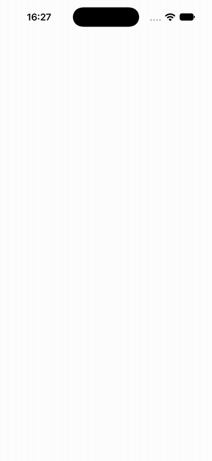
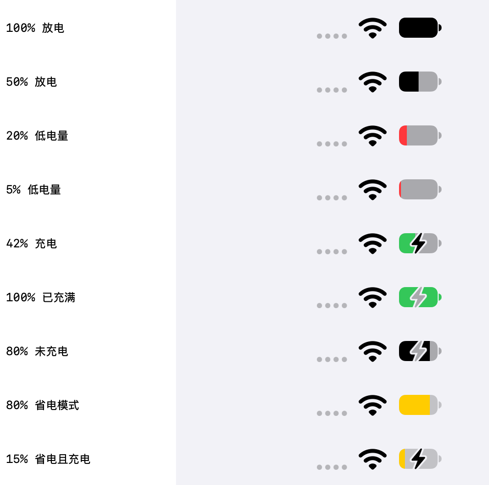

# simulator-re

逆向 iOS Simulator 的学习项目。从 CoreSimulator 一路追到 SpringBoard 里的状态栏，最后做了一个能在模拟器里实时调状态栏的 App。

<p align="center">
  
</p>

## 做到了什么

| 成果 | 说明 |
|---|---|
| `simre` | Swift CLI，不链接私有框架，也不调用 `simctl`，就能列出、启动、关闭设备并改状态栏 |
| 状态栏实验室 | SwiftUI App，在模拟器内直接写系统的覆盖数据，不依赖 host |
| 低电量模式 | 黄色电池，`simctl status_bar` 和 `SimDevice` 都做不到 |
| 电池图标还原 | 从反汇编还原选色、闪电、填充宽度的逻辑，并逐项实测 |

## 电池图标的状态

下图都是 App 实际渲染的结果。

<p align="center">
  
</p>

颜色的优先级是 **省电 > 低电量 > 充电 > 默认**。闪电是否显示单独判断，所以会出现“红色加闪电”这样的组合。

## 状态栏是怎么工作的

```text
simre / simctl
  → SimDevice → CoreSimulatorBridge（运行在模拟器内）
  → status-bar-overrides 域 ← 状态栏实验室直接写这里
  → systemstatusd
  → SpringBoard：STUIStatusBarDataAggregator
  → SBStatusBarWindow 上的 STUIStatusBar
```

几个有意思的发现：

- Xcode 27 没有 Simulator.app，取而代之的是 `DeviceHub.app`。
- 状态栏不在 App 进程里，而是 SpringBoard 盖在 App 上方的一个独立窗口。
- 时间字段没有格式限制，可以显示 `hello`。
- 电量 ≤1% 时按 0 处理，低电量阈值是 20%（iPad 的常量是 10%）。

`systemstatusd` 内部的转发过程还没有抓到，这段目前只有静态证据。

## 快速开始

需要 macOS、Xcode 27 和 iOS 27.0 模拟器运行时。

运行 App：

```sh
open apps/StatusBarLab/StatusBarLab.xcodeproj
```

选一台模拟器后运行即可。

使用 CLI：

```sh
swift build
.build/debug/simre list
.build/debug/simre boot <名称或UDID>
.build/debug/simre statusbar <设备> time 9:41
.build/debug/simre statusbar <设备> battery 1 42    # 状态：0 放电，1 充电，2 已充满
.build/debug/simre statusbar <设备> wifi 3 2        # 模式 3 为已连接，2 格
.build/debug/simre statusbar <设备> clear
.build/debug/simre shutdown <设备>
```

用 `--demo` 启动 Debug 版 App，会自动演示一遍所有预设：

```sh
xcrun simctl launch <设备> dev.ieuforu.StatusBarLab --demo
```

## 目录

| 路径 | 内容 |
|---|---|
| `Sources/simre/` | CLI |
| `apps/StatusBarLab/` | 状态栏实验室和 UI 测试 |
| `tools/simprobe/` | 在模拟器内内省 ObjC 类 |
| `tools/sbtrace/` | 注入 SpringBoard，追踪状态栏更新 |
| `tools/lldb/annotate.py` | 让反汇编显示常量和实例变量名 |
| `tools/ovrtest/` | 直接发布覆盖数据的原型 |
| `notes/` | 逆向笔记 |

## 笔记

1. [架构摸底与设备启动](notes/01-architecture.md)
2. [状态栏链路与 App 原理](notes/02-status-bar.md)
3. [电池图标的代码还原](notes/03-battery-view.md)

## 限制

- 只在 Xcode 27.1、iOS 27.0 模拟器上验证过。私有 API 随时可能变化。
- 只能在模拟器运行，不能用于真机，也不能上架。
- 在 DeviceHub 打开时运行 `xcodebuild test`，可能会让所有模拟器关机，DeviceHub 也一起退出。遇到过，原因还没查明。

## 声明

个人学习项目，与 Apple 无关。`notes/03-battery-view.md` 里的代码是根据反汇编手工还原的伪代码，不是 Apple 的原始源码。
