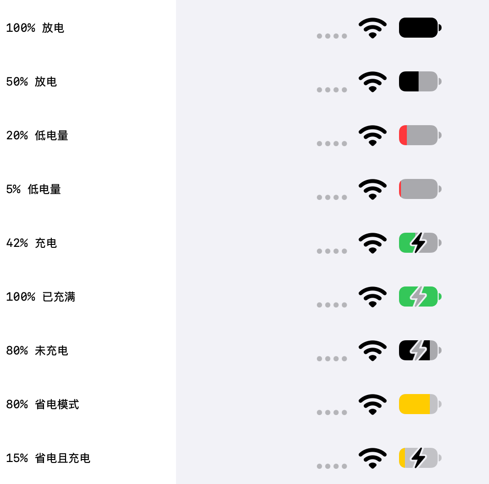

# simulator-re

逆向 iOS Simulator 的学习项目。从 CoreSimulator 一路追到 SpringBoard 里的状态栏，最后做了一个能在模拟器里实时调状态栏的 App。

## 当前状态

- 更新：2026-11-17；**本次状态栏核心视觉研究已完成并结项**。成果基线为 `33c5722`，结项范围与证据边界见 [10](notes/10-statusbar-modes.md#8-结项范围与证据边界)。
- 研究对象：时间、电池、Wi-Fi、蜂窝；两份 iOS 18 / 27 Sketch 的普通状态栏与控制中心；已安装 iOS 17.4 / 27.0 Simulator 的 provider、样式和实际渲染。不是全部系统版本、全部状态栏项目的逆向。
- 设计稿结论：普通电池填充 r=2.5、控制中心 r≈3.33，普通外框保存 r≈4.3；控制中心 cap 为椭圆减矩形。10 组缓存 / original 记录一致，完整来源与图层参数见 [09](notes/09-sketch-status-bars.md)。iOS 18 原稿已读完本次相关组件，不需要安装旧运行时才能确认这些设计数值。
- 系统结论：电池 cap、连续圆角、闪电镂空及百分比见 [04](notes/04-legacy-battery.md)–[06](notes/06-legacy-geometry.md)；旧信号和机型差异见 [07](notes/07-signal-geometry.md)；provider 选型和逐项覆盖见 [08](notes/08-provider-selection.md)；控制中心展开、新 Wi-Fi 符号绘制和蜂窝圆角表见 [10](notes/10-statusbar-modes.md)。
- 已验证：17.4 的 8 条 cap 路径控制点差 0、84 张旧信号图像 alpha 差 0、516 次 provider 比较；27 的 171 次 provider 比较、19 档 Wi-Fi 参数、190 张图像 RGBA 差 0、480 根蜂窝柱误差≤1.78e-15。两版共 6 组状态回放通过，10 份有效截图与 3 张对比图已检查。
- 结项检查：研究工具构建、脚本语法、证据完整性和文档链接通过；另执行 `swift build`、`simre list`、StatusBarLab 通用 iOS Simulator Debug 构建，均成功。修复的 batovr 17.4 completion 崩溃已经两版回放验证。未运行会影响其他模拟器的 UI test。
- 交付入口：[设计稿测量图](docs/images/sketch18-battery-measurements.png)、[系统模式对比图](docs/images/statusbar-runtime-comparison.png)、[状态回放图](docs/images/statusbar-state-comparison.png)。源码与文本证据随仓库维护；Apple 原始 UI Kit / DMG、框架二进制和完整运行时 inventory 不入库。
- 证据边界：iOS 18 数值来自 Sketch，未做该版本运行时动态验证；未做 Sketch 原生像素渲染。真机、完整 RTL、双 SIM、横屏、显示缩放、动画全帧和其他状态项不在本次验收范围，不作为自动延续的项目待办。
- 环境与发布：实验探针已退出，本次创建的实验设备已清理，用户原有设备与运行时保留。原始采集在 `.build/statusbar/`，结项构建记录在 `.build/closure/`。交付渠道为 Git 仓库；**无 deploy 事项，不需要浏览器登录或额外下载运行时**。

<p align="center">
  
</p>

## 做到了什么

| 成果 | 说明 |
|---|---|
| `simre` | Swift CLI，不链接私有框架，也不调用 `simctl`，就能列出、启动、关闭设备并改状态栏 |
| 状态栏实验室 | SwiftUI App，在模拟器内直接写系统的覆盖数据，不依赖 host |
| 低电量模式 | 黄色电池，`simctl status_bar` 和 `SimDevice` 都做不到 |
| 电池图标还原 | 从反汇编还原选色、闪电、填充宽度的逻辑，并逐项实测 |
| 信号图标几何还原 | 同一 iOS 17.4 比较刘海 / 灵动岛的三档尺寸，重绘 Wi-Fi 路径与蜂窝连续圆角，验证实际图层和布局 |
| Provider 选型与样式 | 还原显示几何到 provider、iconScale 到 iconSize，以及区域字体与电池 rounded 的覆盖链 |
| 设计稿与控制中心核对 | 读取 18 / 27 Sketch，追踪 expanded 模式；验证 27 新 Wi-Fi、蜂窝和 provider 参数，区分设计字段与实际布局 |
| 电池像素级还原 | iOS 17.4 和 iOS 27 的几何、贴图、闪电和百分比，独立重绘与真实状态栏逐像素比对 |

## 电池图标的状态

下图都是 App 实际渲染的结果。

<p align="center">
  
</p>

颜色的优先级是 **省电 > 低电量 > 充电 > 默认**。闪电是否显示单独判断，所以会出现“红色加闪电”这样的组合。

## 状态栏是怎么工作的

```text
simre / simctl
  → SimDevice → CoreSimulatorBridge（运行在模拟器内）
  → status-bar-overrides 域 ← 状态栏实验室直接写这里
  → systemstatusd
  → SpringBoard：STUIStatusBarDataAggregator
  → SBStatusBarWindow 上的 STUIStatusBar
```

几个有意思的发现：

- Xcode 27 没有 Simulator.app，取而代之的是 `DeviceHub.app`。
- 状态栏不在 App 进程里，而是 SpringBoard 盖在 App 上方的一个独立窗口。
- 时间字段没有格式限制，可以显示 `hello`。
- 电量 ≤1% 时按 0 处理，低电量阈值是 20%（iPad 的常量是 10%）。

`systemstatusd` 内部的转发过程还没有抓到，这段目前只有静态证据。

## 快速开始

需要 macOS、Xcode 27 和 iOS 27.0 模拟器运行时。

运行 App：

```sh
open apps/StatusBarLab/StatusBarLab.xcodeproj
```

选一台模拟器后运行即可。

使用 CLI：

```sh
swift build
.build/debug/simre list
.build/debug/simre boot <名称或UDID>
.build/debug/simre statusbar <设备> time 9:41
.build/debug/simre statusbar <设备> battery 1 42    # 状态：0 放电，1 充电，2 已充满
.build/debug/simre statusbar <设备> wifi 3 2        # 模式 3 为已连接，2 格
.build/debug/simre statusbar <设备> clear
.build/debug/simre shutdown <设备>
```

用 `--demo` 启动 Debug 版 App，会自动演示一遍所有预设：

```sh
xcrun simctl launch <设备> dev.ieuforu.StatusBarLab --demo
```

## 目录

| 路径 | 内容 |
|---|---|
| `Sources/simre/` | CLI |
| `apps/StatusBarLab/` | 状态栏实验室和 UI 测试 |
| `tools/simprobe/` | 在模拟器内内省 ObjC 类 |
| `tools/sbtrace/` | 注入 SpringBoard，追踪状态栏更新 |
| `tools/lldb/annotate.py` | 让反汇编显示常量和实例变量名 |
| `tools/ovrtest/` | 直接发布覆盖数据的原型 |
| `tools/battery/` | 采集真实状态栏电池、导出参数表、独立重绘并逐像素比对 |
| `tools/signals/` | Wi-Fi / 蜂窝参数探针、SpringBoard 采集、独立重绘、alpha 比对与图解 |
| `tools/providers/` | provider 条件测试、逐图标样式采集、映射还原及反汇编导出 |
| `tools/sketch/` | Sketch 状态栏测量、来源追踪、缓存与 original master 核对 |
| `tools/statusbar/` | 控制中心采集、27 新信号与规则验证、状态回放及比较图 |
| `notes/` | 逆向笔记 |

## 笔记

1. [架构摸底与设备启动](notes/01-architecture.md)
2. [状态栏链路与 App 原理](notes/02-status-bar.md)
3. [电池图标的代码还原](notes/03-battery-view.md)
4. [旧版电池图标：iOS 17.4](notes/04-legacy-battery.md)
5. [新版电池图标：iOS 27](notes/05-ios27-battery.md)
6. [旧版圆润电池：cap、连续圆角与路径验证](notes/06-legacy-geometry.md)
7. [旧版状态栏：Wi-Fi、蜂窝与刘海 / 灵动岛布局](notes/07-signal-geometry.md)
8. [Provider 如何选择机型、iconSize 与逐图标 rounded](notes/08-provider-selection.md)
9. [两份 Apple Sketch：普通状态栏与控制中心](notes/09-sketch-status-bars.md)
10. [从设计稿追到系统：展开模式、新 Wi-Fi 与圆角表](notes/10-statusbar-modes.md)

## 限制

- 实验使用 Xcode 27.1；电池和信号研究覆盖 iOS 17.4 / 27.0 的指定样本，iOS 18 仅有设计稿。CLI / App 的验证范围见对应笔记，不能从某项研究推广到所有功能。私有 API 随时可能变化。
- 只能在模拟器运行，不能用于真机，也不能上架。
- 在 DeviceHub 打开时运行 `xcodebuild test`，可能会让所有模拟器关机，DeviceHub 也一起退出。遇到过，原因还没查明。

## 声明

个人学习项目，与 Apple 无关。算法说明与对应代码是根据反汇编和实测手工还原的研究成果，不是 Apple 的原始源码；设计稿测量另行标明来源，不声称与系统渲染等同。
