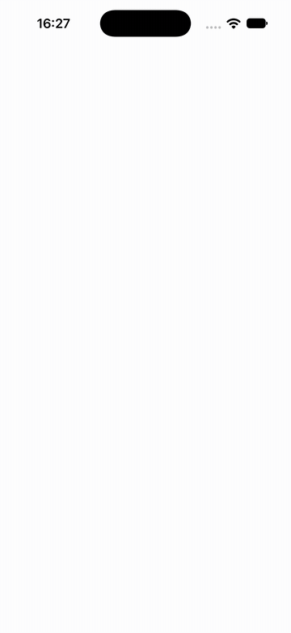

# simulator-re

逆向 iOS Simulator 的学习项目。从 CoreSimulator 一路追到 SpringBoard 里的状态栏，最后做了一个能在模拟器里实时调状态栏的 App。

## 当前状态

- 更新：2026-11-17；研究基线：`cd8910f`（provider 阶段）。设计稿与展开模式扩展的成果、代码及验证记录见第 09 / 10 篇。
- 已完成：电池 cap 两分支、连续圆角和闪电镂空的还原；iOS 17.4 下 8 条 cap 路径控制点误差为 0。范围与限制见 [06](notes/06-legacy-geometry.md)。
- 本阶段完成：iOS 17.4 下 iPhone 14 / 15 Pro / 15 Pro Max 的 Wi-Fi、蜂窝参数、圆角、间距与右侧布局；独立还原 4 / 7 / 8 档的两种 rounded 分支。研究结论、代码、图解与证据入口见 [07](notes/07-signal-geometry.md)。
- 已验证：48 张原生实例图 + 36 张 SpringBoard Wi-Fi mask，alpha 最大差 0；48 根实际蜂窝柱的 frame 与圆角配置匹配。6 张稳定截图已目视核对。纠正旧推断：本次灵动岛电池 rounded=YES，Wi-Fi / 蜂窝仍是 NO，不能从全局样式推断每个项目。
- 信号阶段收尾：研究工具构建、脚本语法和文档链接检查通过；该阶段的三台实验模拟器已删除，原始采集保留在 `.build/signals/`。
- Provider 阶段完成：屏幕 exclusion rect → Phone 家族 → 九类刘海匹配 / 393 阈值 → iconScale 到 iconSize 映射 → 区域字体与电池专属覆盖，见 [08](notes/08-provider-selection.md)。172 组条件在三台 iOS 17.4 模拟器上共 516 次原生比较通过；18 份实际应用样式与覆盖链、view 最终值匹配。
- Provider 阶段收尾：工具构建、Python / shell 语法、文档链接及差异检查通过；等待反汇编的进程已终止，三台本阶段实验设备已删除。原始采集在 `.build/providers/`，仓库保存可复核的代码与文本证据。
- 设计稿阶段完成：读取用户提供的 iOS 27 Sketch，并取得 Apple CDN 的 iOS 18 Templates + Guides。普通电池填充 r=2.5、控制中心 r≈3.33，普通外框存储 r≈4.3；控制中心 cap 保留椭圆减矩形的布尔结构。18 的 10 组缓存 / original 记录一致，来源哈希和测量见 [09](notes/09-sketch-status-bars.md)。原稿不入库。
- 系统扩展完成：17.4 / 27 控制中心实际调用栈、mode→expanded→scale/size/布局；27 DynamicSplit 的 402 / 285 阈值与新档位映射；27 实际 Wi-Fi 使用 SF Symbols 的新类，蜂窝非 rounded 半径表和垂直偏移也改变。见 [10](notes/10-statusbar-modes.md)。
- 本次验证：171 次 27 provider 原生比较、19 档 Wi-Fi 参数、190 张 Wi-Fi 图像（RGBA 差 0）、480 根蜂窝柱（误差≤1.78e-15）；两版共 6 组充电 / 百分比 / 省电 / 深色状态回放通过。修复旧 batovr completion 在 17.4 发布后崩溃；10 份有效截图和 3 张对比图已检查。
- 本次收尾：电池 / 状态栏工具构建、Python / shell 语法、证据完整性、文档链接与差异检查通过；两个等待探针已终止，两台本阶段实验设备已删除。原始采集保留在 `.build/statusbar/`。
- 当前限制：iOS 18 只有设计稿，官方 Xcode 下载请求未能取得运行时，不能用 17.4 代替 18。尚未验证 Sketch 原生像素渲染、真机、双 SIM、横屏、显示缩放、完整 RTL 和搜索动画全帧；定位 / VPN / 通话等其他项目也不能算已通关。完整范围与下一步见 [10 的覆盖表](notes/10-statusbar-modes.md#8-完成范围与尚未完成)。
- 发布范围：Git 发布分支为 `origin/main`；本轮将 09 / 10、对应工具、三张图解、验证证据及接续说明纳入同一提交。用户已授权 commit / push / deploy；仓库没有部署配置，部署目标尚待指定，未执行部署。

<p align="center">
  
</p>

## 做到了什么

| 成果 | 说明 |
|---|---|
| `simre` | Swift CLI，不链接私有框架，也不调用 `simctl`，就能列出、启动、关闭设备并改状态栏 |
| 状态栏实验室 | SwiftUI App，在模拟器内直接写系统的覆盖数据，不依赖 host |
| 低电量模式 | 黄色电池，`simctl status_bar` 和 `SimDevice` 都做不到 |
| 电池图标还原 | 从反汇编还原选色、闪电、填充宽度的逻辑，并逐项实测 |
| 信号图标几何还原 | 同一 iOS 17.4 比较刘海 / 灵动岛的三档尺寸，重绘 Wi-Fi 路径与蜂窝连续圆角，验证实际图层和布局 |
| Provider 选型与样式 | 还原显示几何到 provider、iconScale 到 iconSize，以及区域字体与电池 rounded 的覆盖链 |
| 设计稿与控制中心核对 | 读取 18 / 27 Sketch，追踪 expanded 模式；验证 27 新 Wi-Fi、蜂窝和 provider 参数，区分设计字段与实际布局 |
| 电池像素级还原 | iOS 17.4 和 iOS 27 的几何、贴图、闪电和百分比，独立重绘与真实状态栏逐像素比对 |

## 电池图标的状态

下图都是 App 实际渲染的结果。

<p align="center">
  
</p>

颜色的优先级是 **省电 > 低电量 > 充电 > 默认**。闪电是否显示单独判断，所以会出现“红色加闪电”这样的组合。

## 状态栏是怎么工作的

```text
simre / simctl
  → SimDevice → CoreSimulatorBridge（运行在模拟器内）
  → status-bar-overrides 域 ← 状态栏实验室直接写这里
  → systemstatusd
  → SpringBoard：STUIStatusBarDataAggregator
  → SBStatusBarWindow 上的 STUIStatusBar
```

几个有意思的发现：

- Xcode 27 没有 Simulator.app，取而代之的是 `DeviceHub.app`。
- 状态栏不在 App 进程里，而是 SpringBoard 盖在 App 上方的一个独立窗口。
- 时间字段没有格式限制，可以显示 `hello`。
- 电量 ≤1% 时按 0 处理，低电量阈值是 20%（iPad 的常量是 10%）。

`systemstatusd` 内部的转发过程还没有抓到，这段目前只有静态证据。

## 快速开始

需要 macOS、Xcode 27 和 iOS 27.0 模拟器运行时。

运行 App：

```sh
open apps/StatusBarLab/StatusBarLab.xcodeproj
```

选一台模拟器后运行即可。

使用 CLI：

```sh
swift build
.build/debug/simre list
.build/debug/simre boot <名称或UDID>
.build/debug/simre statusbar <设备> time 9:41
.build/debug/simre statusbar <设备> battery 1 42    # 状态：0 放电，1 充电，2 已充满
.build/debug/simre statusbar <设备> wifi 3 2        # 模式 3 为已连接，2 格
.build/debug/simre statusbar <设备> clear
.build/debug/simre shutdown <设备>
```

用 `--demo` 启动 Debug 版 App，会自动演示一遍所有预设：

```sh
xcrun simctl launch <设备> dev.ieuforu.StatusBarLab --demo
```

## 目录

| 路径 | 内容 |
|---|---|
| `Sources/simre/` | CLI |
| `apps/StatusBarLab/` | 状态栏实验室和 UI 测试 |
| `tools/simprobe/` | 在模拟器内内省 ObjC 类 |
| `tools/sbtrace/` | 注入 SpringBoard，追踪状态栏更新 |
| `tools/lldb/annotate.py` | 让反汇编显示常量和实例变量名 |
| `tools/ovrtest/` | 直接发布覆盖数据的原型 |
| `tools/battery/` | 采集真实状态栏电池、导出参数表、独立重绘并逐像素比对 |
| `tools/signals/` | Wi-Fi / 蜂窝参数探针、SpringBoard 采集、独立重绘、alpha 比对与图解 |
| `tools/providers/` | provider 条件测试、逐图标样式采集、映射还原及反汇编导出 |
| `tools/sketch/` | Sketch 状态栏测量、来源追踪、缓存与 original master 核对 |
| `tools/statusbar/` | 控制中心采集、27 新信号与规则验证、状态回放及比较图 |
| `notes/` | 逆向笔记 |

## 笔记

1. [架构摸底与设备启动](notes/01-architecture.md)
2. [状态栏链路与 App 原理](notes/02-status-bar.md)
3. [电池图标的代码还原](notes/03-battery-view.md)
4. [旧版电池图标：iOS 17.4](notes/04-legacy-battery.md)
5. [新版电池图标：iOS 27](notes/05-ios27-battery.md)
6. [旧版圆润电池：cap、连续圆角与路径验证](notes/06-legacy-geometry.md)
7. [旧版状态栏：Wi-Fi、蜂窝与刘海 / 灵动岛布局](notes/07-signal-geometry.md)
8. [Provider 如何选择机型、iconSize 与逐图标 rounded](notes/08-provider-selection.md)
9. [两份 Apple Sketch：普通状态栏与控制中心](notes/09-sketch-status-bars.md)
10. [从设计稿追到系统：展开模式、新 Wi-Fi 与圆角表](notes/10-statusbar-modes.md)

## 限制

- 实验使用 Xcode 27.1；电池和信号研究覆盖 iOS 17.4 / 27.0 的指定样本，iOS 18 仅有设计稿。CLI / App 的验证范围见对应笔记，不能从某项研究推广到所有功能。私有 API 随时可能变化。
- 只能在模拟器运行，不能用于真机，也不能上架。
- 在 DeviceHub 打开时运行 `xcodebuild test`，可能会让所有模拟器关机，DeviceHub 也一起退出。遇到过，原因还没查明。

## 声明

个人学习项目，与 Apple 无关。算法说明与对应代码是根据反汇编和实测手工还原的研究成果，不是 Apple 的原始源码；设计稿测量另行标明来源，不声称与系统渲染等同。
