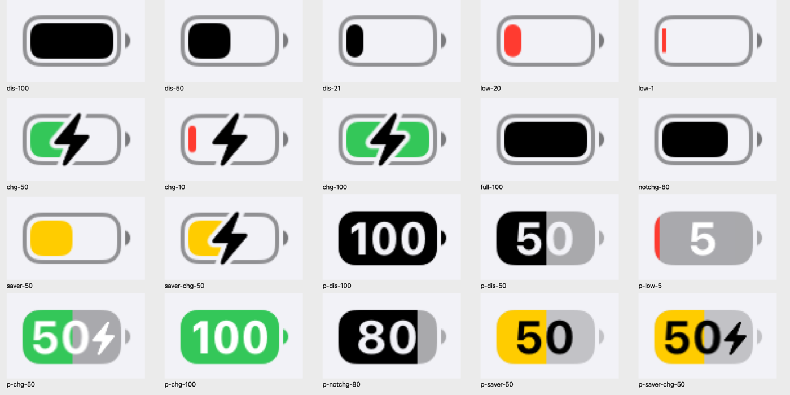

# 04 旧版电池图标：iOS 17.4

iOS 17.4 状态栏的电池：描边外壳、留缝、实心填充、右侧小凸头。本篇把它的每个像素来源讲清楚，包括百分比和闪电。

两个版本共用的渲染管线（贴图、挖洞、闪电和文字定位、动画）写在本篇，iOS 27 只写差异，见 [05](05-ios27-battery.md)。

方法名、常量和实例变量是真实的；局部变量名和注释是还原时加的。代码是根据反汇编手工还原的伪代码，不是 Apple 的原始源码。

<p align="center">
  
</p>

上图都是 SpringBoard 里真实状态栏的截屏（iPhone 15 Pro，浅色外观，放大 4 倍）。

## 结论先看

| 项 | 值（iPhone 15 Pro，iconSize 7） |
|---|---|
| 整体 | 27⅓ × 13 pt，显示百分比时 27⅓ × 13⅔ |
| 外壳 | 25 × 13，描边 1pt，路径内缩 0.5，圆角 = 12 / 3.125 = **3.84**（连续曲率） |
| 留缝 | 1pt（描边内沿到填充） |
| 填充 | (2, 2, 21 × 电量, 9)，圆角 = 9 / 3.125 = **2.88**，四角都圆 |
| 凸头 | 1⅓ × 4.5，x = 26（与外壳间隔 1pt），垂直居中；形状是半径 2.25 的圆被切下的一段 |
| 颜色 | 外壳 `labelColor` α0.4，凸头 α0.5，填充 `labelColor` |
| 闪电 | 32×40 路径 × 0.3768，中心对齐外壳中心，比外壳略高（−0.19 到 13.19） |
| 闪电周围的缝 | 外壳和填充上挖掉“胖闪电”，约 1pt 宽 |

## 研究方法

| 步骤 | 工具 | 得到什么 |
|---|---|---|
| 1 | `tools/battery/sbbattery.m` 注入 SpringBoard（只读） | 真实状态栏电池视图的属性、图层树、每一层的贴图 |
| 2 | `tools/battery/batovr.m` 发布电池覆盖 | 切换电量、充电状态、省电、百分比 |
| 3 | `xcrun simctl io screenshot` | 真实像素 |
| 4 | `tools/battery/iconsizes.m` | 每档 iconSize 的参数表（和真机逐项一致） |
| 5 | `tools/lldb/annotate.py` 反汇编 | 规则和公式 |
| 6 | `tools/battery/batrender.m` 独立重绘 + `compare.swift` | 闭环验证，见文末 |

一开始我用 `initWithFrame:` 直接创建 `_UIBatteryView` 测量，得到外壳 23⅔ × 11⅓、圆角 2.5，**这不是状态栏的样子**。原因是 `initWithFrame:` 把 `internalSizeCategory` 设成 1，走的是另一套尺寸。真实状态栏里 `internalSizeCategory = 0`、`iconSize = 7`、`rounded = YES`，尺寸来自 `STUIStatusBarStaticBatteryView` 的 iconSize 表。以 SpringBoard 里的真实视图为准。

## 类和图层

```
STUIStatusBarStaticBatteryView   （SystemStatusUI，按 iconSize 查参数表）
  → _UIStaticBatteryView          （UIKitCore，预渲染位图 + contentsMultiplyColor）
    → _UIBatteryView              （UIKitCore，状态、颜色、定位、动画）
```

```
view.layer              filters = [gaussianBlur]，因此整体离屏合成，destOut 只挖电池自己
├─ bodyLayer            外壳位图（尺寸 = 视图 bounds），乘外壳色
│  └─ percentFillLayer  填充位图（尺寸 = 填充 frame），乘填充色
├─ pinLayer             凸头位图，乘凸头色
├─ percentageLabel      UILabel，只在显示百分比时出现
├─ boltMaskLayer        胖闪电位图，compositingFilter = destOut
└─ boltLayer            闪电位图，乘闪电色
```

每张位图都是黑色形状、透明背景，用 `UIGraphicsImageRenderer`（非不透明，按屏幕倍率）渲染，以 `_UISignalViewCacheKey` 为键缓存。颜色不画进位图，而是通过图层的 `contentsMultiplyColor` 乘上去，所以换颜色不用重新渲染。

位图的像素尺寸向上取整，再按 `contentsGravity = resize` 拉伸进图层 frame。frame 不在像素格上时（比如凸头 x = 27.0833），边缘会有一点重采样模糊，这也是真实外观的一部分。

## 参数表

`STUIStatusBarStaticBatteryView` 的 `+_batterySizeForIconSize:` 等方法是按 iconSize（1–17）查的表。下表是 iOS 17.4 的完整取值，由 `iconsizes.m` 直接调用得到。线宽同时也是外壳与凸头的间距。

| iconSize | 外壳 | 凸头 | 线宽 | 百分比字号 |
|---|---|---|---|---|
| 1 | 22 × 11.5 | 1.25 × 4.5 | 1 | 9 |
| 2 | 22 × 11⅓ | 1⅓ × 4⅔ | 1 | 11⅓ |
| 3 | 20⅔ × 11⅓ | 1⅓ × 4 | 1 | 10⅓ |
| 4 | 22⅔ × 12 | 1⅓ × 4 | 1 | 11⅓ |
| 5 | 24 × 12.5 | 1.5 × 4.5 | 1 | 12 |
| 6 | 24 × 12⅓ | 1⅓ × 5 | 1 | 12 |
| **7** | **25 × 13** | **1⅓ × 4.5** | **1** | **11⅔** |
| 8 | 28⅓ × 14⅓ | 1⅔ × 5 | 7/6 | 13⅔ |
| 9 | 28 × 14 | 1.75 × 5.5 | 1.25 | 12 |
| 10 | 27⅓ × 13⅔ | 1.5 × 5 | 7/6 | 13 |
| 11 | 29 × 15 | 1.75 × 6 | 1.25 | 13 |
| 12 | 29 × 14⅔ | 1⅚ × 5⅔ | 7/6 | 13 |
| 13 | 30 × 15⅓ | 1⅚ × 6 | 7/6 | 13 |
| 14 | 24 × 12 | 1.5 × 4.5 | 1 | 9 |
| 15 | 28 × 14 | 1.75 × 5.5 | 1.25 | 10 |
| 16 | 22 × 11.5 | 1.25 × 4.5 | 1 | 9 |
| 17 | 22 × 11⅓ | 1⅓ × 4⅔ | 1 | 9 |

iconSize 7 的其余参数：闪电系数 `_batteryBoltScaleFactorMultiplier` = 1.1304（26/23），百分比模式闪电系数 = 11⅔ / 11.5 × 0.7 = 0.7101，文字垂直微调 = ⅓，满电时文字水平微调 = ⅓。表里的 `outsideCornerRadius` 和 `insideCornerRadius` 在 rounded 模式下不使用。

## 几何

```objc
// 显示百分比时外壳高度 + 2/scale
CGSize battery = [self _batterySizeForTraitCollection:t];             // 25 × 13
CGFloat lw = [self _lineWidthAndInterspaceForTraitCollection:t];        // 1

// -[_UIBatteryView _bodyRectForTraitCollection:]
CGRect body = (CGRect){bounds.origin, battery};
if (!_showsPercentage) body = CGRectInset(body, lw / 2, lw / 2);       // 描边，路径压在线中间

// -[_UIStaticBatteryView _updateBodyLayers]
CGFloat bodyR = self.rounded ? body.size.height / 3.125                // 12 / 3.125 = 3.84
                             : outsideR - lw / 2;
UIBezierPath *p = [UIBezierPath bezierPathWithRoundedRect:body cornerRadius:bodyR];   // 连续曲率
p.lineWidth = _showsPercentage ? 0 : lw;
[p stroke];                     // 无百分比：只描边
if (_showsPercentage) [p fill]; // 有百分比：实心（lineWidth 0 的 stroke 会多画一圈 1px 细线）

pinLayer.frame = CGRectMake(battery.width + lw,                         // 26：外壳和凸头间隔一个线宽
                            CGRectGetMidY(bounds) - pin.height / 2, pin.width, pin.height);
```

### 凸头路径

```objc
// +[_UIBatteryView _pinBezierPathForSize:isComplex:NO]
CGFloat r = h / 2, d = r - w, a = acos(d / r);       // 圆心在凸头左侧 d 处
[p moveToPoint:CGPointMake(0, r - sqrt(r * r - d * d))];
[p addArcWithCenter:CGPointMake(-d, r) radius:r startAngle:a endAngle:-a clockwise:NO];
[p closePath];
// isComplex（internalSizeCategory == 2 才用）：右侧两个圆角半径等于凸头宽度的矩形
```

### 填充

```objc
// -[_UIBatteryView _fillLayerFrame:cornerRadius:]（无百分比）
CGRect fill = CGRectInset((CGRect){0, 0, battery}, 2 * lw, 2 * lw);   // 线 + 缝
CGFloat r = self.rounded ? fill.size.height / 3.125 : insideR;        // 9 / 3.125 = 2.88
fill.size.width *= chargePercent;                                      // 先不取整
if (fill.size.width < 2 * r) {           // 太窄时：圆角改成宽度一半，高度上下各收一点
    CGFloat k = (r - fill.size.width / 2) / 2;
    fill.origin.y += k; fill.size.height -= 2 * k; r = fill.size.width / 2;
}
fill.size.width = MAX(UIRoundToViewScale(fill.size.width), 1.0);       // 最后才取整，至少 1pt

// 有百分比：填充从外壳左上角开始，高度等于外壳
fill = CGRectMake(0, 0, MAX(UIRoundToViewScale(battery.width * chargePercent), 1), battery.height);
```

两个容易忽略的细节，都已实测：

- 判断“太窄”和计算圆角用的是**取整前**的宽度。1% 在数据层就被当成 0（见 [03](03-battery-view.md)），所以未取整宽度是 0、圆角是 0，最后得到一根上下各收 1.44 的**直角**细条，宽 1pt。
- 填充位图在无百分比时是独立的圆角矩形，四角都圆；有百分比时是整块外壳形状按宽度裁出来的，右边是直边。

## 颜色（浅色外观，实测）

| 部位 | 规则 |
|---|---|
| 外壳 | 无百分比：`bodyColor` = `labelColor` α0.4，任何状态都不变 |
| 凸头 | 无百分比：`pinColor` = `labelColor` α0.5 |
| 外壳和凸头（百分比） | 电量 ≥ 99.5% 时等于填充色；否则 `labelColor` α0.3，省电时 α0.2 |
| 填充 | 省电 → `systemYellow`；否则低电量 → `systemRed`；否则充电中 → `systemGreen`；否则 `labelColor` |
| 闪电（无百分比） | `labelColor` |

实测颜色：红 (255, 59, 48)，绿 (52, 199, 89)，黄 (255, 204, 0)。低电量阈值 20%（包含 20%），iPad 是 10%。

### 数据状态到视图状态

| 数据层 state | 含义 | iOS 17.4 chargingState | 外观 |
|---|---|---|---|
| 0 | 放电 | 0 | 无闪电 |
| 1 | 充电 | 1 | 绿色加闪电 |
| 2 | 已充满 | **0** | 和放电一样，无闪电 |
| 3 | 未充电 | **0** | 和放电一样，无闪电 |

这是 iOS 17.4 的实测映射，和 iOS 27 不同：iOS 27 中 2 → 3、3 → 4，会显示灰色闪电。

## 闪电怎么贴上去

闪电路径定义在 32 × 40 的坐标系里，两个版本完全相同：

```objc
// +[_UIBatteryView _boltBezierPathForSize:]（坐标原样，4 位小数）
M 12.4290,37.0230  L 27.2720,19.1520
C 27.5830,18.7790 27.7380,18.4220 27.7380,18.0340
C 27.7380,17.3040 27.1790,16.7920 26.4180,16.7920
L 17.2580,16.7920  L 22.0240,4.3090
C 22.7380,2.4770 20.8130,1.4830 19.5710,2.9740
L 4.7280,20.8440
C 4.4170,21.2170 4.2620,21.5740 4.2620,21.9780
C 4.2620,22.6920 4.8210,23.2200 5.5820,23.2200
L 14.7420,23.2200  L 9.9760,35.6880
C 9.2620,37.5350 11.1870,38.5130 12.4290,37.0230  Z

// +[_UIBatteryView _boltMaskBezierPath]：同一个闪电向外扩约 3 个单位，尖角改成平头
M 27.8280,-2.5000  L 20.1720,-2.5000  L 17.2860,0.9480  L 2.3510,18.9290
C 1.5790,19.8560 1.1880,20.8860 1.1880,21.9900
C 1.1880,24.3730 3.0900,26.2400 5.5170,26.2400
L 10.3760,26.2400  L 7.1400,34.7050  L 4.1800,42.5000  L 11.8340,42.5000
L 14.7140,39.0480  L 29.6480,21.0670
C 30.4210,20.1400 30.8130,19.1150 30.8130,18.0210
C 30.8130,15.6380 28.9120,13.7710 26.4840,13.7710
L 21.6230,13.7710  L 24.8580,5.2990  L 27.8280,-2.5000  Z
```

### 尺寸

```
闪电图层 bounds = 32 × 40 × pathScale(2/3) = 21⅓ × 26⅔，位图 64 × 80 px
图层 transform  = scale(_batteryBoltLargeScaleFactor 0.5 × 系数)
  无百分比：系数 = _batteryBoltScaleFactorMultiplier       = 1.1304 → 路径总缩放 0.3768
  有百分比：系数 = _percentageBatteryBoltScaleFactorMultiplier = 0.7101 → 路径总缩放 0.2367
```

| 模式 | 闪电图层框 | 闪电可见部分 | 位置 |
|---|---|---|---|
| 无百分比 | 12.06 × 15.07 | 8.85 × 13.38 | 中心 = 外壳中心 (12.5, 6.5) |
| 有百分比 | 7.57 × 9.47 | 5.56 × 8.40 | 跟在数字后面，见下节 |

### 挖缝

无百分比时，闪电周围的缝是**烘焙进位图**的：

```objc
// -[_UIStaticBatteryView _useImagesWithCutoutsForBolt]
return !self.showsPercentage && _inflightBoltAnimationCount == 0 && self._shouldShowBolt;

// +[_UIStaticBatteryView _imageByPunchingImage:...]：先画外壳（或填充），再用 destinationOut 画胖闪电
[body drawInRect:... blendMode:kCGBlendModeNormal alpha:1];
[boltMask drawInRect:boltRect blendMode:kCGBlendModeDestinationOut alpha:1];   // blendMode 23
```

外壳和填充两张位图都要挖，凸头不挖。`boltRect` 与闪电图层的 frame 相同，所以缝和闪电严格同心。从路径算，缝的宽度约 1pt。

`boltMaskLayer`（挂 `destOut` 的实时图层）只在闪电出现或消失的动画期间使用，平时是隐藏的。显示百分比时它的不透明度为 0，所以百分比模式下闪电周围**没有缝**。

### 什么时候显示

```objc
- (BOOL)_shouldShowBolt {
    BOOL room = _showsPercentage ? (_chargePercent < 0.995) : YES;   // 显示 100 时不放闪电
    return _showsInlineChargingIndicator && _chargingState != 0 && room;
}
- (BOOL)_boltIsInactive { return _chargingState > 2; }               // 3 已充满、4 未充电
```

## 百分比

<p align="center">
  
</p>

### 文字和字体

- 文字是 `[NSString localizedStringWithFormat:@"%.0f", MAX(chargePercent * 100, 1)]`，0% 也显示成 1。
- 字体是 `.SFUI-Bold` 11⅔pt。显示 100 时实测变成 `.SFUI-SemiCondensedBold`；这条只有实测，没有在 17.4 的反汇编里逐条核对。
- 颜色：省电时用 `systemBlackColor`，其余用 `systemWhiteColor`。

### 镂空

```objc
- (BOOL)_batteryTextIsCutout {
    return !self.saverModeActive && (self.chargingState & ~4) == 0 && !self.isLowBattery;
}   // 不省电、chargingState 为 0 或 4、不是低电量
```

镂空时数字图层和闪电图层的 `compositingFilter` 都设为 `destOut`，穿过填充和外壳露出背景。不镂空时，数字是白字（红、绿填充上）或黑字（黄色省电填充上）。

### 定位

```objc
// -[_UIBatteryView _updateLightningBoltAndPercentagePosition]
CGRect body = [self _bodyRectForTraitCollection:t];
[self _updatePercentageFont];
[label sizeToFit];
CGFloat cy = CGRectGetMidY(body) + [self _percentTextVerticalAdjustmentForTraitCollection:t];   // +⅓
CGFloat cx;
if (self._shouldShowBolt) {
    CGFloat space = lw + lw + 2 / scale + pctBoltMult * (1 / 3.0) * (32 / 3.0);  // 5.19
    cx = CGRectGetMidX(body) - space / 2;                // 数字左移，给闪电腾位置
} else {
    cx = CGRectGetMidX(body);
    if (_chargePercent >= 0.995) cx += [self _percentTextXAdjustmentWhenFullForTraitCollection:t];
}
CGFloat ox = cx - label.bounds.size.width / 2, oy = cy - label.bounds.size.height / 2;
cx = cx + (ox - UIRoundToViewScale(ox));   // ← 符号是 +：水平方向反而偏离了像素格
cy = cy - (oy - UIRoundToViewScale(oy));   //   垂直方向是 −：正常对齐
label.center = CGPointMake(cx, cy);

CGPoint boltCenter = CGPointMake(CGRectGetMidX(body) + label.frame.size.width / 2, cy);   // 闪电紧贴数字右侧
boltLayer.position = boltMaskLayer.position = boltCenter;
// 无百分比时：两者都放在 (midX, midY)
```

水平方向的取整多半是写反了：系统把“原点到像素格的误差”加了回去，而不是减掉。实测充电 50% 时数字原点 x = 1.8084，不在像素格上，和这个公式完全吻合。

## 动画

以下来自 iOS 27 的反汇编，17.4 的方法名和结构相同，但没有逐条核对。

| 事件 | 动画 |
|---|---|
| 闪电出现 | 首次时创建图层，缩放从 0.375 × 系数 到 0.5 × 系数，不透明度 0 → 1；百分比模式 0.25s，否则 0.5s |
| 闪电消失 | 缩回 0.375 × 系数，不透明度 → 0，0.5s；结束后如果仍为 0，就从父图层移除 |
| 闪电动画期间 | `_inflightBoltAnimationCount` 加 1，外壳和填充改用不挖洞的位图，缝由实时的 `boltMaskLayer`（destOut）提供；结束后减 1，换回挖好洞的位图 |
| 颜色变化 | `CATransaction` 0.5s |
| 百分比文字和颜色切换 | `UIView transitionWithView:` 交叉淡化，时长沿用当前动画 |
| 百分比出现和消失 | 标签 alpha 0.5s 淡入，0.25s 淡出 |
| RTL 布局 | 视图 `sublayerTransform` 水平翻转，闪电再翻转回来（`_unflipBoltIfNecessary`） |

## 验证

`tools/battery/batrender.m` **不调用任何电池类的绘制逻辑**，只用本篇的规则和路径重绘每个状态。唯一借用系统的是数字的字体对象。重绘的输入取自真实视图的状态，再用 `compare.swift` 与 SpringBoard 截屏逐像素比较（3x，sRGB）：

| 状态 | 平均差（0–255） | 差 > 32 的像素 |
|---|---|---|
| 放电 21% / 50% / 100%、已充满、未充电 | 0.18–0.43 | 0–0.24% |
| 低电量 1% / 20% | 0.19–0.28 | 0.09% |
| 省电 | 0.10 | 0 |
| 充电 10% / 50% / 100%、省电充电 | 0.91–1.55 | 0.46–0.76% |
| 百分比：放电、低电量、未充电、省电、充电 100（无闪电） | 0.09–0.45 | 0–0.28% |
| 百分比：充电 50%、省电充电 | 1.59–2.14 | 0.34–1.47% |

剩余差异都只出现在边缘，宽度约 1 像素：闪电外缘和数字边缘。我的推测是：位图贴在非整数坐标上，闪电位图还要经过约 0.57 倍的图层缩放，合成时发生了重采样。我用 `kCGInterpolationLow` 近似 Core Animation 的过滤（三种插值里误差最小），但两者并不完全相同。

## 尚未验证

- 17.4 的 `-[_UIBatteryView _updateBolt]` 和 `_updatePercentageFont` 没有逐条核对，相关结论来自 27 的反汇编加 17.4 的实测。
- “100 用 SemiCondensed 字体”只有实测。
- 深色外观下 17.4 的颜色没有采集。
- 数据层 state 4（无法充电）在 17.4 上没有采集。
