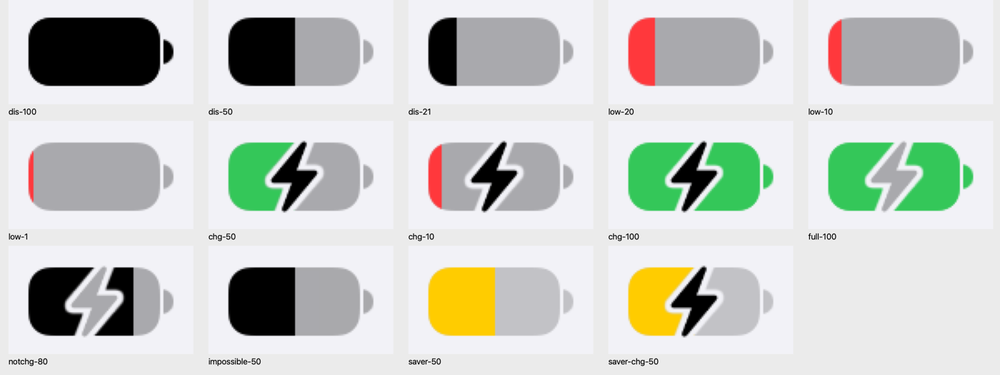
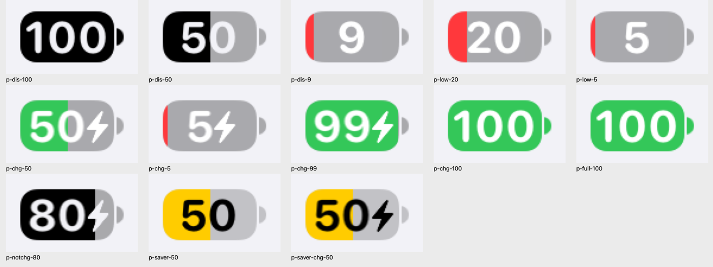
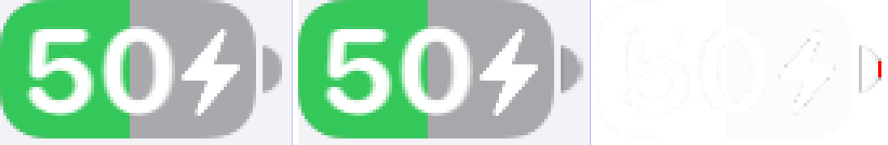

# 05 新版电池图标：iOS 27

iOS 27 状态栏的电池：半透明实心药丸，填充是直边，闪电压在电池上并挖出一圈缝。渲染管线和 iOS 17.4 相同（同样的类、同样的位图加乘色、同样的闪电路径和定位公式），共用部分见 [04](04-legacy-battery.md)。本篇写 iOS 27 的参数和差异。

<p align="center">
  
</p>

<p align="center">
  
</p>

以上都是 SpringBoard 里真实状态栏的截屏（iPhone 17 Pro，浅色外观，放大 4 倍）。

## 和 iOS 17.4 的区别

| 项 | iOS 17.4 | iOS 27 |
|---|---|---|
| 外壳 | 描边 1pt，路径内缩 0.5 | **实心填充**，不内缩 |
| 外壳颜色（无百分比） | `labelColor` α0.4，固定 | α0.3（省电 α0.2），**满电时变成填充色** |
| 凸头 | 1⅓ × 4.5，α0.5 | **2 × 5**，和外壳同色 |
| 填充 | 内缩 2pt，四角都圆 | 不内缩，**右边是直边**（整块外壳形状按宽度裁切） |
| 闪电挖缝 | 挖描边和填充 | 挖外壳和填充 |
| 已充满 / 未充电 | 不显示闪电 | 显示**灰色闪电**（α0.3） |
| 红色 | (255, 59, 48) | (255, 56, 60) |
| 百分比字体 | `.SFUI-Bold` 11⅔ | **SF Pro Rounded StatusBar** Bold 12⅓ |

## 结论先看（iPhone 17 Pro，iconSize 8）

| 项 | 值 |
|---|---|
| 整体 | 29.0833 × 13⅔；状态栏把视图宽度对齐到像素，实际是 29 |
| 外壳 | 26⅓ × 13⅔，圆角 = 13⅔ / 3.125 = **4.373**（连续曲率），显示百分比时 26⅓ × 14⅓，圆角 4.587 |
| 凸头 | 2 × 5，x = 27.0833（间隔 0.75），垂直居中 |
| 填充 | (0, 0, 取整(26⅓ × 电量)，至少 1, 13⅔)，裁自外壳形状 |
| 闪电（无百分比） | 32×40 路径 × 0.3961，可见部分 9.30 × 14.06，比外壳高，上下各超出约 0.2pt |
| 闪电（有百分比） | 路径 × 0.2502，可见部分 5.87 × 8.88 |
| 百分比字号 | 12⅓ |

## 参数表

由 `tools/battery/iconsizes.m` 调用 `STUIStatusBarStaticBatteryView`（`rounded = YES`）得到。iOS 27 有 19 档，凸头一律 2 × 5。

| iconSize | 外壳 | 线宽 | 字号 | 充电时窄体 |
|---|---|---|---|---|
| 1 | 22 × 11.5 | 1 | 9 | 是 |
| 2 | 22 × 11⅓ | 1 | 11⅓ | 是 |
| 3 | 20⅔ × 11⅓ | 1 | 10⅓ | 是 |
| 4 | 22⅔ × 12 | 1 | 11⅓ | 是 |
| 5 | 24 × 12.5 | 1 | 12 | 是 |
| 6 | 24 × 12⅓ | 1 | 12 | 是 |
| 7 | 25 × 13 | ⅚ | 11⅔ | 否 |
| **8** | **26⅓ × 13⅔** | **0.75** | **12⅓** | **否** |
| 9 | 28⅓ × 14⅓ | 7/6 | 13⅔ | 否 |
| 10 | 29⅓ × 15 | 7/6 | 14 | 否 |
| 11 | 28 × 14 | 1.25 | 12 | 是 |
| 12 | 27⅓ × 13⅔ | 7/6 | 13 | 是 |
| 13 | 29 × 15 | 1.25 | 13 | 是 |
| 14 | 29 × 14⅔ | 7/6 | 13 | 是 |
| 15 | 30 × 15⅓ | 7/6 | 13 | 是 |
| 16 | 24 × 12 | 1 | 11.5 | 否 |
| 17 | 28 × 14 | 1.25 | 10 | 是 |
| 18 | 22 × 11.5 | 1 | 9 | 是 |
| 19 | 22 × 11⅓ | 1 | 9 | 是 |

iconSize 8 的闪电系数 = 1.1884（= 外壳高 13⅔ / 11.5），百分比模式闪电系数 = 12⅓ / 11.5 × 0.7 = 0.7507，文字垂直微调 = ⅓，满电时文字水平微调 = ⅓。

“充电时窄体”为“是”的档位，在充电或满电时字体换成 `wght 700, wdth 80` 的窄体变体。iPhone 17 Pro 的第 8 档不换。

## 几何

```objc
// -[_UIBatteryView _bodyRectForTraitCollection:]：iOS 27 不再内缩
CGRect body = (CGRect){bounds.origin, battery};

// -[_UIStaticBatteryView _updateBodyLayers]
CGFloat r = self.rounded ? body.size.height / [self _roundedCornerRadiusFactor]   // 3.125
                         : outsideR;
bodyImage = 填充 [UIBezierPath bezierPathWithRoundedRect:body cornerRadius:r];     // 不描边
pinLayer.frame = CGRectMake(battery.width + lw, CGRectGetMidY(bounds) - 2.5, 2, 5);

// -[_UIBatteryView _fillLayerFrame:cornerRadius:]
CGFloat w = UIRoundToViewScale(battery.width * chargePercent);
if (useMinimumWidth) w = MAX(w, 1.0);
fillFrame = CGRectMake(0, 0, w, battery.height);

// +[_UIStaticBatteryView _percentFillImageWithSize:forScale:batteryRect:cornerRadius:]
// 位图大小 = 填充 frame；里面画整块外壳圆角矩形（宽度至少 2r），超出位图的部分被裁掉 → 右边是直边
```

## 颜色

```objc
// -[_UIBatteryView _batteryUnfilledColor]：外壳和凸头
return _chargePercent >= 0.995 ? self._batteryFillColor : self.inactiveColor;

// -[_UIBatteryView inactiveColor]（状态栏没有另外指定时）
if (style == UIUserInterfaceStyleDark) {
    if (saver)                         return [white colorWithAlphaComponent:0.5];
    if (isLowBattery || chargingState) return [white colorWithAlphaComponent:0.3];
    return [white colorWithAlphaComponent:0.5];
}
return [black colorWithAlphaComponent:saver ? 0.2 : 0.3];

// -[_UIBatteryView _batteryFillColor]：优先级 省电 > 低电量 > 充电 > 默认
// 系统色用改过 accessibilityContrast / userInterfaceStyle 的 trait 解析，所以不随深浅色变化
if (saver)              return systemYellow;   // (255, 204, 0)
if (isLowBattery)       return systemRed;      // (255, 56, 60)
if (state != 0 && != 4) return systemGreen;    // (52, 199, 89)
return self.fillColor;                         // 状态栏设成 labelColor

// 闪电
showsPercentage ? (inactive ? _textBoltInactiveColor : _batteryTextColor)
                : (inactive ? _boltInactiveColor     : _boltColor);
// _boltColor = labelColor；_boltInactiveColor = labelColor α0.3（深色 α0.5）
// _batteryTextColor = 省电 ? systemBlack : systemWhite
// _textBoltInactiveColor = 文字色，不镂空时再乘 α0.6
```

### 数据状态到视图状态

| 数据层 state | 含义 | chargingState | 外观 |
|---|---|---|---|
| 0 | 放电 | 0 | 无闪电 |
| 1 | 充电 | 1 | 绿色（低电量时为红色）加黑色闪电 |
| 2 | 已充满 | 3 | 闪电为 α0.3 |
| 3 | 未充电 | 4 | 填充是默认色，闪电为 α0.3 |
| 4 | 无法充电 | 0 | 和放电一样 |

## 闪电和百分比

闪电路径、挖缝方式、显示条件、数字定位公式（包括水平方向取整写反的问题）都和 17.4 相同，见 [04](04-legacy-battery.md)。iOS 27 的具体数值：

| 项 | 无百分比 | 有百分比 |
|---|---|---|
| 图层缩放 | 0.5 × 1.1884 = 0.5942 | 0.5 × 0.7507 = 0.3754 |
| 闪电图层框 | 12.676 × 15.845，原点 (6.8285, −1.0894) | 8.008 × 10.010 |
| 闪电中心 | 外壳中心 (13.1667, 6.8333) | (13.1667 + 数字宽 / 2, 7.5) |
| 周围的缝 | 有，烘焙进外壳和填充位图 | 无 |
| 给闪电让出的宽度 | — | 2 × 0.75 + ⅔ + 0.7507 × 32/9 = 4.836 |

实测数字原点（全部和公式吻合）：

| 状态 | 数字 | 原点 x | 说明 |
|---|---|---|---|
| 放电 50% | 50 | 4.6667 | 居中 |
| 放电 9% | 9 | 9.0 | 居中，取整 |
| 充电 50% | 50 | 2.1641 | 左移 2.418，水平取整写反，不在像素格上 |
| 放电 100% | 100 | 1.3333 | 满电水平微调 +⅓ |

<p align="center">
  
</p>

## 验证

方法同 [04](04-legacy-battery.md)：独立重绘，再和 SpringBoard 截屏逐像素比较（3x，sRGB）。

| 状态 | 平均差（0–255） | 差 > 32 的像素 |
|---|---|---|
| 放电 21% / 50% / 100%、无法充电 | 0.35–0.55 | 0.13–0.53% |
| 低电量 1% / 10% / 20% | 0.55–0.62 | 0.13% |
| 省电 | 0.35 | 0.13% |
| 充电 10% / 50% / 100%、已充满、未充电、省电充电 | 1.42–2.08 | 0.37–2.09% |
| 全部 13 个百分比状态 | 0.29–0.59 | 0.12–0.49% |

误差最大的是无百分比的闪电边缘：64 × 80 的闪电位图经过 0.594 倍的图层缩放，我用 `kCGInterpolationLow` 近似 Core Animation 的过滤，两者并不完全相同。其余状态里固定的 5 个像素，是凸头左缘落在 x = 27.0833 时的重采样差异。这两点都是推测，没有单独做实验证明。

## 尚未验证

- 深色外观只读了反汇编，只采集了一个状态（放电 50%：外壳和凸头白色 α0.5）。
- iconSize 8 以外的档位只用探针取了参数，没有和真机截屏比对。
- 视图图层上的 `gaussianBlur` 滤镜，推测是给状态栏过渡动画用的，平时半径为 0，没有核实。
