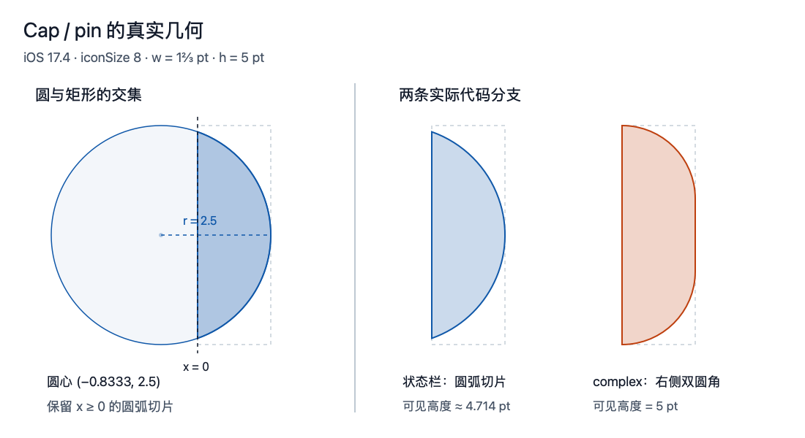
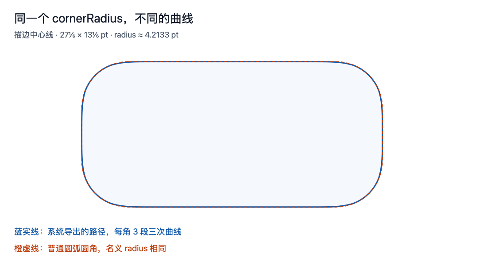

# 06 旧版圆润电池：从 Sketch 布尔形状到实际绘制代码

目标是参考截图里的描边电池，重点检查右侧 cap、圆角、填充和闪电留缝。**本次实际分析的是 iOS 17.4（21E213）模拟器的 UIKitCore**，尺寸采用与截图接近的 iconSize 8。截图的准确系统版本仍未知，没有把它认定为 iOS 18。

下面是根据反汇编和运行时路径还原的代码与解释，不是 Apple 原始源码。类名、方法名、常量和控制点来自系统；变量名和说明由本项目补写。

## cap 是一个圆弧切片

Apple 在这段实现里把 cap 叫作 **pin**。实际入口：

```objc
+[_UIBatteryView _pinBezierPathForSize:isComplex:]
```



状态栏使用 `isComplex = NO`。从几何上看，确实可以在 Sketch 里用“圆与矩形取交集”做出来；但系统这个方法没有执行通用路径布尔运算，而是直接计算交点、画圆弧、闭合路径。

给定名义宽 `w`、高 `h`：

```text
r = h / 2                  圆半径
d = r − w                  圆心到切线的水平距离
圆心 C = (−d, r)
切线 x = 0
交点 y = r ± sqrt(r² − d²)
圆弧角度 a = acos(d / r)
```

用图形软件表达就是：圆 `C=(-d,r), radius=r` 与矩形 `[0,w] × [0,h]` 取交集。系统实际实现可还原为：

```objc
CGFloat r = h / 2;
CGFloat d = r - w;
CGFloat halfChord = sqrt(r * r - d * d);
CGFloat angle = acos(d / r);

UIBezierPath *p = [UIBezierPath bezierPath];
[p moveToPoint:CGPointMake(0, r - halfChord)];
[p addArcWithCenter:CGPointMake(-d, r)
            radius:r
        startAngle:angle
          endAngle:-angle
         clockwise:NO];
[p closePath];
```

这里有一个容易读反的细节：先 `moveTo` **上交点**，而 `startAngle=+angle` 对应 UIKit 坐标下的**下交点**。`addArc` 会自动补一条从当前位置到圆弧起点的直线，所以执行顺序是：上交点 → 左侧竖线 → 下交点 → 沿右边圆弧回到上交点。不是遗漏了 `addLineToPoint:`。

完整、可编译的两分支还原在 [BatteryGeometry.h](../tools/battery/BatteryGeometry.h)。它只用公开 UIKit 绘图 API，不调用电池私有类。

### 第 8 档的精确数字

| 项 | 数值（pt） |
|---|---|
| 名义图层宽高 | 1.6666667 × 5 |
| 圆半径 | 2.5 |
| 圆心 | (−0.8333333, 2.5) |
| 上下交点 | (0, 0.1429774)、(0, 4.8570226) |
| 形状的可见高度 | 4.7140452，而不是 5 |
| 圆弧角跨度 | 约 141.0576°，不是半圆的 180° |
| 图层在电池内的位置 | x=29.5，y=4.6666667 |

因此 cap 没有水平的顶边和底边，右侧也没有直线。它不是“矩形右侧加两个圆角”，也不是半圆。

### 为什么导出的控制点看着有点“不规则”

`addArc` 的输出最终是三次贝塞尔路径。第 8 档实测元素为 **M、L、C、C、Z**。两段 C 没有均分圆弧角度，控制点看起来并不镜像；这是系统圆弧转贝塞尔的输出，不是该方法手写了一组不规则控制点。

实际 `CGPath` 的最大 x 约为 **1.667348**，比名义宽 1.666667 多约 **0.000681pt**，符合圆弧贝塞尔近似带来的微小偏差。在 3× 下约为 0.002px，不能用它解释肉眼可见的模糊。

### 另一条分支确实像圆角矩形

`isComplex = YES` 的实现不同：

```objc
[p moveToPoint:CGPointZero];
[p addArcWithCenter:CGPointMake(0, w) radius:w
        startAngle:3 * M_PI_2 endAngle:0 clockwise:YES];
[p addLineToPoint:CGPointMake(w, h - w)];
[p addArcWithCenter:CGPointMake(0, h - w) radius:w
        startAngle:0 endAngle:M_PI_2 clockwise:YES];
[p closePath];
```

它的右上、右下各有一段四分之一圆，中间是竖直直线，左边闭合。`_UIStaticBatteryView _updateBodyLayers` 里明确使用 `internalSizeCategory == 2` 选择这条分支；我们研究的状态栏布局为 category 0，走圆弧切片。

## 外壳的“圆角半径”不是四分之一圆的半径

第 8 档外壳为 `28⅓ × 14⅓ pt`，线宽 `7/6 pt`。路径内缩半个线宽，防止描边跑出名义尺寸：

```objc
CGRect body = CGRectInset(CGRectMake(0, 0, 85/3.0, 43/3.0), 7/12.0, 7/12.0);
CGFloat radius = body.size.height / 3.125;  // 4.2133333 pt
UIBezierPath *outline = [UIBezierPath bezierPathWithRoundedRect:body
                                                cornerRadius:radius];
outline.lineWidth = 7/6.0;
[outline stroke];
```

**3.125 已在本次 17.4 反汇编里直接确认**：`_updateBodyLayers +220` 和 `_fillLayerFrame:cornerRadius: +188` 都有 `fmov ... #3.125`，不再只是沿用其他版本的推断。

在此运行时，公开 `bezierPathWithRoundedRect:cornerRadius:` 会传入 `legacyCorners=NO`，进入 continuous 路径。导出的外壳每个角实际有 **3 段三次贝塞尔**，整个外壳共 12 段 C。



两种轮廓在这个尺寸下很接近，不能只看截图就认定是哪种曲线。图中的曲线类型是从导出路径确定的。连续圆角对直边到弯曲部分作了过渡，而不是把一个完整四分之一圆直接接到直线上。

本组参数的顶部直线起点距左侧约 `6.440775pt`，大于名义 radius `4.213333pt`。前者包括整段过渡的长度；不要把它误认为实际使用了一个 6.44pt 的圆半径，也不要假定同名 `cornerRadius` 在其他绘图库中会产生相同路径。

## 填充会随低电量收缩高度

无百分比时，线宽和内侧空隙分别都是 `7/6 pt`。所以填充原点是 `(7/3, 7/3)`，满电尺寸为 `71/3 × 29/3 pt`：

```objc
CGRect fill = CGRectInset(CGRectMake(0, 0, W, H), 2 * lw, 2 * lw);
CGFloat r = fill.size.height / 3.125;
fill.size.width *= chargePercent;

if (fill.size.width < 2 * r) {
    CGFloat insetY = (r - fill.size.width / 2) / 2;
    fill.origin.y += insetY;
    fill.size.height -= 2 * insetY;
    r = fill.size.width / 2;
}
fill.size.width = MAX(round(fill.size.width * scale) / scale, 1);
```

计算顺序不能交换：**先用未取整宽度处理圆角和高度，再对齐像素，再保底 1pt**。例如第 8 档 10% 电量，填充宽最终为 `7/3 pt`，高度约 `7.756667 pt`。它不是把满电填充水平裁掉，也不是全程保持原高度。

实现上填充位图使用私有 `_continuousRoundedCARectBezierPath:...`。本次导出了第 8 档满电填充，和公开 `bezierPathWithRoundedRect:cornerRadius:` 的 **22 个路径元素及所有坐标完全一致**。这只证明这组参数可替代，没有证明两套 API 在任意长宽、任意半径下都等价。

另一个源码层细节：17.4 的 `_fillLayerFrame:cornerRadius:` 真实签名是 **`void` 返回，通过 `CGRect *` 和 `CGFloat *` 写出结果**。不要把方法名里的第一个参数当作 BOOL，也不要直接用返回 CGRect 的函数指针调用它。运行时类型编码保存在证据 JSON 中。

## 闪电的“黑边”实际上是透明缺口

外壳、填充、凸头先分别渲染为带 alpha 的位图，之后再乘色。白色闪电周围的暗色不是固定黑描边，而是露出的背景。

稳态无百分比充电图标的处理顺序：

1. 画外壳或填充的原始位图。
2. 将一张更胖的闪电蒙版，用 **destinationOut** 从该位图挖掉。
3. 分别合成外壳、填充、凸头。
4. 把正常尺寸的白色闪电放在上面。

本次在 `_imageByPunchingImage:...` 的 block 里确认了两次绘图：第一次 blend mode 0（normal），第二次 **23（destinationOut）**。胖闪电是独立路径；并非简单地对细闪电统一加一圈 stroke，其尖端还做了截平。原始蒙版控制点已导出到 JSON。

无百分比且没有正在进行的闪电动画时使用预挖好的贴图。`_useImagesWithCutoutsForBolt` 的条件已重新核对：`!showsPercentage && inflightBoltAnimationCount == 0 && shouldShowBolt`。动画中实时蒙版的完整时间线沿用 [04](04-legacy-battery.md) 的既有研究，本次没有重新逐帧采集。

## 证据与复现

- [cap 的可编译还原代码](../tools/battery/BatteryGeometry.h)：两个分支，不调用私有电池类。
- [路径探针](../tools/battery/pathprobe.m)：调用系统方法，导出路径，并与还原路径逐元素比对。
- [运行时路径及类型编码](evidence/battery-geometry-ios17.4.json)：所有浮点控制点，未做拟合。
- [注释后的反汇编](evidence/battery-geometry-ios17.4.asm)：使用本次运行时导出的 ivar 偏移；地址只对应本次加载。
- [研究图生成程序](../tools/battery/geometry-figure.swift)：读取路径 JSON 绘图，可直接用保存的证据重新生成。

```sh
zsh tools/battery/build.sh
# D 为已启动的 iOS 17.4 模拟器 UDID。
xcrun simctl spawn "$D" "$PWD/.build/battery/pathprobe" "$PWD/.build/battery/geometry"
xcrun swift tools/battery/geometry-figure.swift \
  notes/evidence/battery-geometry-ios17.4.json docs/images
```

验证结果：4 组有效尺寸 × 两个 cap 分支，共 **8 条路径，所有元素类型相同，最大控制点坐标差为 0**。比较对象是系统 API 的真实输出，不是与另一个手写公式自比。这里的“0”只针对本次同一运行时下的路径构造，不代表整张参考截图已经像素级一致，也不覆盖所有可能尺寸和未来系统版本。
