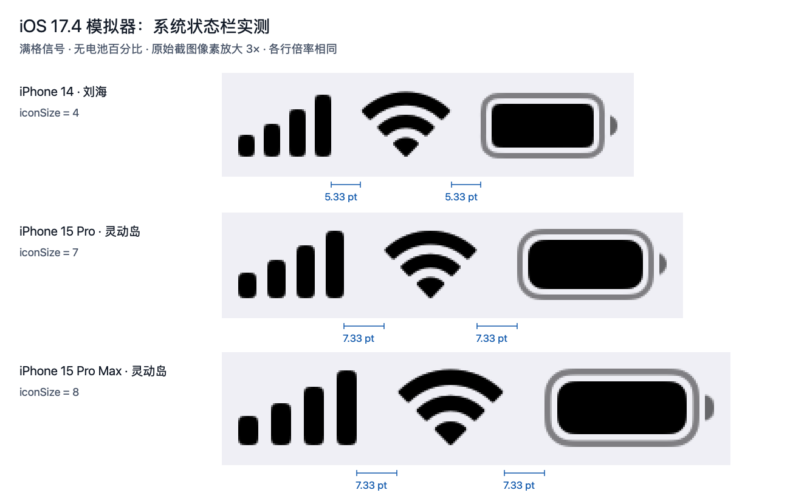
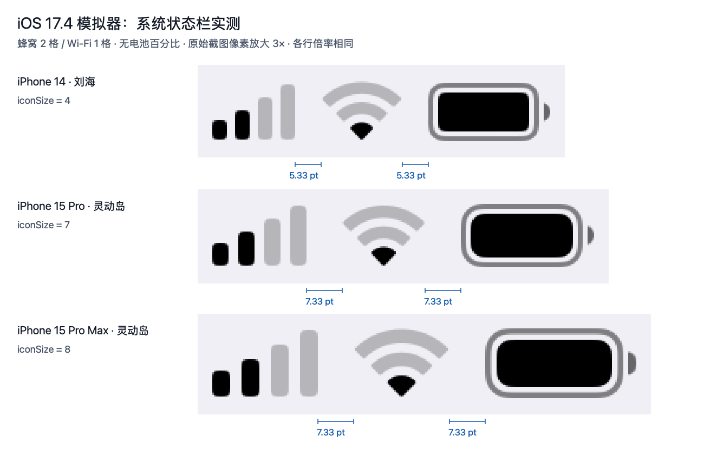
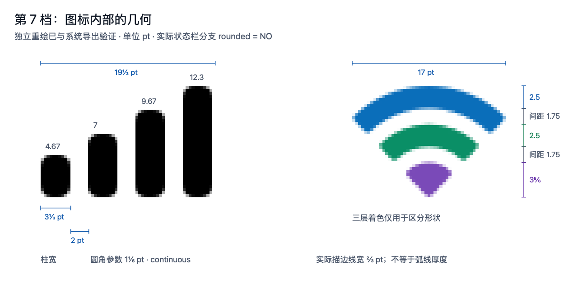

# 旧版状态栏：Wi-Fi、蜂窝图标与刘海 / 灵动岛布局

记录日期：2026-11-17。基线：电池研究提交 `8259621`。本篇是 iOS **17.4（21E213）arm64 Simulator** 的实测和反汇编还原，不是 Apple 原始源码，也不是 iOS 18 或真机验证。

## 先纠正 rounded 的理解

**灵动岛并不意味着右侧所有图标都收到 `rounded = YES`。** 同一条状态栏里，各项目收到的 style attributes 可以不同。

| 实测机型 | `iconSize` | 蜂窝 rounded | Wi-Fi rounded | 电池 rounded |
|---|---:|---|---|---|
| iPhone 14，刘海 | 4 | NO | NO | NO |
| iPhone 15 Pro，灵动岛 | 7 | NO | NO | YES |
| iPhone 15 Pro Max，灵动岛 | 8 | NO | NO | YES |

此前从“都调用 `applyStyleAttributes:`”推断“它们会一起进入 rounded 分支”不成立。这次包装原方法、原样传参并记录调用后的值，直接观察到了差别：

- 蜂窝、Wi-Fi 收到的 font 是 `.SFUI-Semibold`，`style.isRounded = NO`，视图 `rounded = NO`。
- 两台灵动岛机型的电池收到 `.AppleSystemUIFontRounded-Medium`，两项 rounded 都是 YES。
- 刘海机型的电池收到 `.SFUI-Semibold`，两项 rounded 都是 NO。

`STUIStatusBarStyleAttributes.isRounded` 检查的是字体的 UIFont design：调用 `CTFontGetUIFontDesign`，与 `kCTFontUIFontDesignRounded` 比较。它不是直接读取“这台设备有没有灵动岛”。设备布局先选择各项目的样式，再影响这个结果。

**`iconSize` 是参数档位，不是圆角半径，也不是直接表示宽度的 pt 数。** 大小、内部间距、各根柱高都各自查表；`rounded` 另行选择绘制分支。即使 rounded 为 NO，图形仍有圆角。

## 同版本、同倍率对比

三台新建实验模拟器均为竖屏、默认显示设置、3× 显示倍率。打开 Settings，固定 9:41，电量 100%、放电、无百分比；采集满格和蜂窝 2 格 / Wi-Fi 1 格两种状态。截图是系统合成画面的裁切，未重画图标，各行使用同一放大倍率。





下列宽高是 view 的 intrinsic size / frame 尺寸，**不是非透明像素的紧致包围盒**。单位 pt；乘 3 才是该实验的设备像素数。

| 参数 | iPhone 14，档 4 | iPhone 15 Pro，档 7 | iPhone 15 Pro Max，档 8 |
|---|---:|---:|---:|
| 蜂窝图标宽 × 高 | 17 × 11⅓ | 19⅓ × 12⅓ | 21⅔ × 13⅔ |
| 对应像素宽 × 高 | 51 × 34 | 58 × 37 | 65 × 41 |
| Wi-Fi 图标宽 × 高 | 16⅔ × 12 | 17 × 12⅓ | 19⅔ × 14 |
| 对应像素宽 × 高 | 50 × 36 | 51 × 37 | 59 × 42 |
| 蜂窝 → Wi-Fi 的 frame 间距 | 5⅓ | 7⅓ | 7⅓ |
| Wi-Fi → 电池的 frame 间距 | 5⅓ | 7⅓ | 7⅓ |
| 电池 view 宽 × 高，包含 cap | 25 × 12 | 27⅓ × 13 | 31 × 14⅓ |

这也说明“灵动岛样式”不是唯一的一组几何值：Pro 与 Pro Max 在此版本分别采用 7、8 档。

## 蜂窝：四根独立的连续圆角柱

类名是 `STUIStatusBarCellularSignalView`，基类是 `STUIStatusBarSignalView`。每一格由一个 `CALayer` 绘制。

| 参数，pt | 档 4 | 档 7 | 档 8 |
|---|---:|---:|---:|
| 单柱宽度 w | 3 | 3⅓ | 3⅔ |
| 柱间空隙 g | 1⅔ | 2 | 2⅓ |
| 非 rounded 分支 cornerRadius | 1 | 1⅙ | 1.2 |
| 从左到右四根高度 | 4、6、8⅔、11⅓ | 4⅔、7、9⅔、12⅓ | 5⅓、7⅔、10⅔、13⅔ |
| `cornerCurve` | continuous | continuous | continuous |

正常信号在视图内部的 `signalMode` 是 2。不要把它与 CLI / 底层覆盖数据里的模式编号直接混用；这不是同一个枚举层。

每根柱子底部对齐。设总高度 H 为第四根柱高，第 i 根柱子的 frame 是：

```text
x = i × (w + g)
y = H − heights[i]
width = w
height = heights[i]

整个图标宽度 = 4w + 3g
```

系统设置的是：

```objc
bar.cornerCurve = kCACornerCurveContinuous;
bar.cornerRadius = rounded ? barWidth / 2 : tableCornerRadius;
```

所以实际 NO 分支仍有连续圆角；YES 分支才把 radius 改为半柱宽。不能把 YES / NO 理解为“有圆角 / 没圆角”。连续圆角的轮廓也不等同于用四段四分之一圆拼出的普通圆角矩形。我们的还原沿用公共 Core Animation 连续圆角渲染，没有声称已恢复其内部曲线算法。

激活的柱子用 activeColor，未激活柱子用 inactiveColor。本次浅色界面是黑色与 alpha 0.2 的黑色；层级中也有白色版本。信号减弱改变颜色，不改变四根柱子的高度。搜索等其他模式不在本次动态验证范围。

## Wi-Fi：三条独立路径，而不是直接缩放一张符号图

类名是 `STUIStatusBarWifiSignalView`。本次路径从底部向外构造，生成三张与图标画布等大的透明 mask，分别放进三个图层并缓存。各层通过颜色 / 透明度体现信号强弱。

| 参数，pt | 档 4 | 档 7 | 档 8 |
|---|---:|---:|---:|
| 画布宽 W | 16⅔ | 17 | 19⅔ |
| 画布高 H | 12 | 12⅓ | 14 |
| 底部一带的标称径向厚度 T₀ | 3½ | 3⅚ | 4⅓ |
| 中间 / 外侧各带标称厚度 T₁、T₂ | 2⁵⁄₁₂ | 2½ | 2⅚ |
| 带间径向间距 g | 1¾ | 1¾ | 1¹¹⁄₁₂ |
| `_barCornerRadius` 返回 c | ⅔ | ⅔ | ⅔ |

这里有三种不同的“间距”：蜂窝柱间空隙、Wi-Fi 带间径向距离、状态栏图标之间的布局距离，不能互相代用。

`_barCornerRadius` 这个名字很容易误导。反汇编实际将 c 交给 `UIBezierPath.lineWidth`，路径同时 fill 和 stroke。默认 NO 分支采用 round line join，使带状轮廓的拐角柔化；它不是给整条 Wi-Fi 弧线设置 `CALayer.cornerRadius = c`。描边在路径两侧各扩张 c/2，也不能把 c 直接称作末端半圆的半径。



图中的 2.5 是 Wi-Fi 带的标称径向厚度，3⅓ 是蜂窝柱宽。用户记忆中的设计稿“2.5 → 3.33”尚无原稿可核对；仅凭数字相近，不能认定它们就是那份稿中的圆角值。

### 默认 NO 分支的路径公式

第 i 带从底部开始编号，先计算：

```text
Dᵢ = Σ(j < i) (Tⱼ + g)     // 该带内侧路径的半径
tᵢ = Tᵢ − c                // 填充路径本体的径向厚度
C = (W/2, H − c/2)         // 圆弧中心
a = acos((W/2) / H)

L(r) = (W/2 − r cos(a), H − r sin(a) − c/2)
R(r) = (W − L(r).x, L(r).y)
```

路径依次为：

1. 从 L(Dᵢ) 出发，沿内圆弧到 R(Dᵢ)。
2. 直线连至 R(Dᵢ + tᵢ)。
3. 沿外圆弧返回 L(Dᵢ + tᵢ)，闭合。
4. `lineJoinStyle = round`，`lineWidth = c`，填充并描边。

底部 D₀ = 0，因此内圆弧退化为一个点。默认底部是圆化的扇形尖角，不是一个独立圆点。画布 H 与最终带状轮廓的总径向跨度也不能一概视作相等；档 4、8 的表项存在少量余量。

### 另一个 rounded = YES 分支

系统确实实现了另一套路径，但本次三台机型的正常 Wi-Fi 状态栏都没有走它。为了确认语义，独立实例强制 YES 做了验证：

- 角度增加 `atan((tᵢ/2)/H)`。
- 中、外带的两端添加半径 `tᵢ/2` 的半圆，再 fill + stroke。
- 底部变为圆心 `(C.x, C.y − t₀/2)`、路径半径 `t₀/2` 的圆。

实际代码见 [SignalGeometry.h](../tools/signals/SignalGeometry.h)，包含两种分支；没有调用私有 Wi-Fi 或蜂窝绘制方法。它使用公共 UIKit / Core Animation 画图，属于可执行的算法还原，不是 Apple 源码泄漏或逐行源码恢复。

## 状态栏上的绝对位置

坐标格式为 `(x, y, width, height)`，单位 pt，原点为屏幕左上角；浮点误差按分数化简。

| 机型 | 蜂窝 frame | Wi-Fi frame | 电池 frame |
|---|---|---|---|
| iPhone 14 | (302⅓, 19, 17, 11⅓) | (324⅔, 18⅓, 16⅔, 12) | (346⅔, 18⅔, 25, 12) |
| iPhone 15 Pro | (282, 23, 19⅓, 12⅓) | (308⅔, 23, 17, 12⅓) | (333, 22⅔, 27⅓, 13) |
| iPhone 15 Pro Max | (305⅓, 22, 21⅔, 13⅔) | (334⅓, 21⅔, 19⅔, 14) | (361⅓, 21⅔, 31, 14⅓) |

对应屏幕尺寸为 390×844、393×852、430×932 pt。`STUIStatusBar` view 的高度分别为 47、54、54 pt；这不是对 safe-area top inset 的测量。

运行时选择的 provider 分别是：

```text
STUIStatusBarVisualProvider_Split1170
STUIStatusBarVisualProvider_DynamicSplitMedium
STUIStatusBarVisualProvider_DynamicSplit
```

本篇测量 provider 选择后的布局结果；后续 [08：provider 选型与逐图标样式](08-provider-selection.md) 已继续还原该版本的普通 iPhone 选择链。不要据此推广到所有机型或其他系统版本。

## 证据与验证

- [参数、实测图层、样式事件与布局](evidence/signals-ios17.4.json)：两类图标各 17 个参数档位；三台设备 × 两种信号状态。层级中含多份状态栏实例，保留原采集顺序，不把它们当作不同设备。
- [带注释的反汇编](evidence/signals-ios17.4.asm)：基类样式应用、字体设计检查、蜂窝布局与圆角、Wi-Fi 路径和生成 block。地址仅对应本次加载，不是稳定 ABI。
- [验证输出](evidence/signals-ios17.4-validation.txt)：记录实际执行结果。

验证由两条独立证据链组成：

1. **系统原生私有 view 实例 vs 手写重绘**：3 档 × 2 种 rounded；Wi-Fi 每档 3 张 mask，共 18 张；蜂窝每档 0–4 激活格，共 30 张。48 张透明图的 alpha 像素一致。
2. **SpringBoard 实际视图 vs 已验证重绘**：6 次采集，每次层级中有两套信号图标，36 张 Wi-Fi mask 的 alpha 像素一致；12 组蜂窝图标、48 根柱子的 frame、cornerRadius、cornerCurve 与已验证原生实例一致。

合计 **84 张图，最大 alpha 差 0**。这里证明的是形状 mask 与相应图层几何，不是整个屏幕的 RGB 逐像素还原；阴影、背景合成和所有状态栏色彩状态没有用这个结果背书。真实截图另作目视验收。早期重启后截图被启动遮罩挡住，已重新打开 Settings、等待转场并重采；最终展示图不使用这些早期截图。

## 复现

要求 Apple Silicon、可用的 Xcode Simulator SDK、已安装 iOS 17.4 运行时。以下命令从仓库根目录执行。只对自己创建的实验设备注入和重启 SpringBoard。

```sh
zsh tools/signals/build.sh

# 三台设备分别用 iPhone-14、iPhone-15-Pro、iPhone-15-Pro-Max 创建。
# 记录返回的 UDID，不要使用 booted 指代用户原有设备。
xcrun simctl create re-signal-notch com.apple.CoreSimulator.SimDeviceType.iPhone-14 com.apple.CoreSimulator.SimRuntime.iOS-17-4
xcrun simctl boot <UDID>
xcrun simctl bootstatus <UDID> -b

# 对三台分别执行，目录分别为 notch、island、island-max。
python3 tools/signals/capture.py <UDID> .build/signals/notch full --inject
python3 tools/signals/capture.py <UDID> .build/signals/notch partial --wifi 1 --cellular 2

# 在任一上述 3× 设备执行。绝对路径替换成自己的仓库位置。
xcrun simctl spawn <UDID> "$PWD/.build/signals/signalprobe" "$PWD/.build/signals/probe"
xcrun simctl spawn <UDID> "$PWD/.build/signals/signalrender" "$PWD/.build/signals/reconstructed"

swift tools/signals/verify.swift .build/signals/probe .build/signals/reconstructed .build/signals > .build/signals/verification.txt
swift tools/signals/figures.swift .build/signals .build/signals/reconstructed docs/images
python3 tools/signals/summarize.py .build/signals notes/evidence/signals-ios17.4.json

# 完成后逐一清理本次创建的实验设备。
xcrun simctl shutdown <UDID>
xcrun simctl delete <UDID>
```

`capture.py` 包装原 `applyStyleAttributes:` 记录样式，调用参数和返回行为保持原样；并非完全不做 hook 的采集。它核对实际信号格数再保存截图，截图仍需要目视确认没有转场、遮挡或裁切。原始采集和构建产物留在忽略目录 `.build/signals/`；仓库只保存代码、研究图和文本证据。

## 当前边界

本阶段覆盖的是旧版普通状态栏右侧三个图标中的 Wi-Fi / 单路蜂窝几何、与电池的间距，以及 3 台机型的样式输入。电池的 cap、填充、闪电与百分比另见 [06](06-legacy-geometry.md) 和前序笔记。

尚未在 iOS 18 / 27 重跑本篇信号验证；未覆盖双 SIM、横屏、显示缩放、热点、通话 / 搜索动画、RTL、所有字体和时间布局。用户提供的原截图不能仅凭外观断定具体系统版本。设计稿提供后，可将其中的画板倍率、宽高、径向厚度、路径描边与真正的 cornerRadius 逐项对应，不把名称或数值巧合当作证据。
