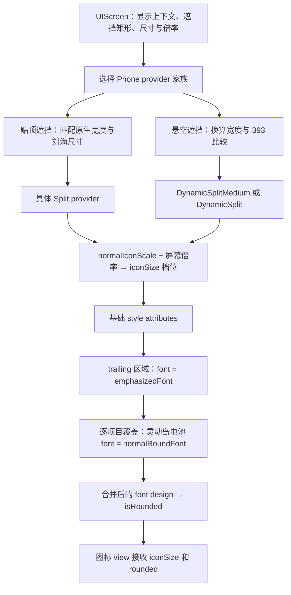

# Provider 如何选机型、iconSize 与逐图标 rounded

日期：2026-11-17。研究基线：`3e9ed16`。范围：**iOS 17.4（21E213）arm64 Simulator**，默认竖屏的 iPhone 14、15 Pro、15 Pro Max。延续 [07：信号几何](07-signal-geometry.md)，这次补齐其上游选型与样式来源。

结论来自原生方法反汇编、构造输入调用原生方法、SpringBoard 实际样式采集三条证据。下面的规则是手工还原，不是 Apple 原始源码，也不把模拟器结果当作真机或其他 iOS 版本保证。

## 一条完整链路



**不是在这层写一串 `if model == iPhone16,1`。** Phone 路径主要消费显示几何；机型先体现在屏幕配置里，再由这些条件选出 provider。

## 1. 从 UIScreen 到 provider 家族

`-[UIScreen _exclusionArea]` 调用 `_displayInfoProvider.exclusionArea`。本次 `_displayInfoProvider` 的实际类是 `UISDisplayContext`；其 `exclusionArea` 是已存储的属性，返回 `UISDisplaySingleRectShape`。

`-[UIScreen _nativeDisplayBounds]` 从显示配置的 `pixelSize` 取得原生宽高。`_unjailedReferenceBounds` 与 `_scale` 从 UIScreen 自身字段读取，`_nativeScale` 转到 `_nativeScaleWithLevel:2`。本篇追到这些显示输入为止，未进一步还原 CoreSimulator 如何生成全部显示上下文配置。

`STUIStatusBar` 在 `_prepareVisualProviderIfNeeded` 中先检查是否已有指定的 provider class；未指定时调用 `STUIStatusBarGetVisualProviderClassForScreen(screen, info)`。外层函数还有三项行为：

- 内嵌屏幕已有缓存时，直接复用缓存的 class。
- 首次选择时，内部 `visualProviderSettings.visualProviderClassName` 若指定了符合 provider 协议的 class，可以覆盖常规选择。
- 原生选择未得到结果时，记录诊断并回退到 `STUIStatusBarVisualProvider_Fallback`。

常规原生入口枚举 iOS provider，再由 `+[STUIStatusBarVisualProvider_iOS visualProviderSubclassForScreen:visualProviderInfo:]` 按 `traitCollection.userInterfaceIdiom` 分流。Phone idiom 为 0；Pad、CarPlay 分支也存在，但本篇不继续还原其内部选型。

Phone 分支的关键逻辑可还原为：

```objc
area = screen._exclusionArea;
if ([area respondsToSelector:@selector(rect)]) {
    if (area.rect.origin.y > 0)
        return specialize(DynamicSplit, screen);
    return specialize(Split, screen);
}
if (internalSettings.legacyPhoneUsesiPadLayout)
    return Pad;
return specialize(LegacyPhone, screen);
```

这里判断的是 **遮挡矩形是否离开屏幕顶部**，不是直接问设备是否有 Face ID，也不是检查一个名为 Dynamic Island 的型号布尔值。构造输入时保留其他尺寸，只把 y 从 0 改为 0.001，原生方法就从 Split1170 改选 DynamicSplitMedium。

`specialize` 对应 `STUIStatusBarGetVisualProviderSubclassForScreenWithVisualProviderInfo`：它检查 class 是否真正提供了相对父类不同的选择方法。有独立实现才继续调用；只有继承实现则返回当前 class，避免无止境递归。

## 2. 灵动岛：393 阈值从哪里来

`+[STUIStatusBarVisualProvider_DynamicSplit visualProviderSubclassForScreen:visualProviderInfo:]` 的计算是：

```text
effectiveWidth = width(screen._unjailedReferenceBounds)
                 × screen._nativeScale
                 ÷ screen._scale

effectiveWidth ≤ 393 → STUIStatusBarVisualProvider_DynamicSplitMedium
effectiveWidth > 393 → STUIStatusBarVisualProvider_DynamicSplit
```

所以不能简单简写成“screen.bounds.width 小于多少”：这里明确使用 reference bounds 和两种倍率。三台实际采集的两种倍率恰好都是 3，才可以约掉。

| 实测设备 | reference width | nativeScale / scale | effectiveWidth | 选择结果 |
|---|---:|---:|---:|---|
| iPhone 15 Pro | 393 | 3 / 3 | 393 | DynamicSplitMedium |
| iPhone 15 Pro Max | 430 | 3 / 3 | 430 | DynamicSplit |

边界实测：393 留在 Medium，393.001 转到 DynamicSplit。构造输入改变 `_scale` 时也按上式切换；这是条件测试，不是已操作并验收系统“显示缩放”的证明。

## 3. 刘海：不仅看屏幕宽度，也看遮挡宽高

Split 分支按以下顺序查找九个候选类：

| Provider 后缀 | 原生显示宽度，px | 参考 notchSize，pt | 特殊 referenceScreenScale |
|---|---:|---:|---:|
| Split1125 | 1125 | 209 × 30 | 无 |
| Split1080 | 1080 | 226 × 34⅓ | 2.88 |
| Split1080_Wide | 1080 | 174 × 37⅓ | 2.88 |
| Split1170 | 1170 | 210 × 32 | 无 |
| Split1170_Wide | 1170 | 161⅓ × 33⅔ | 无 |
| Split1242 | 1242 | 209⅓ × 30 | 无 |
| Split828 | 828 | 227 × 32 | 无 |
| Split1284 | 1284 | 209⅓ × 32 | 无 |
| Split1284_Wide | 1284 | 161⅓ × 33⅔ | 无 |

每个候选需要同时满足：

```text
abs(candidate.nativeDisplayWidth − screen._nativeDisplayBounds.width) ≤ 0.0001

denominator = candidate 有 referenceScreenScale
              ? candidate.referenceScreenScale : screen._scale
ratio = screen._nativeScale / denominator

abs(candidate.notchSize.width  − exclusionRect.width  × ratio) ≤ 0.0001
abs(candidate.notchSize.height − exclusionRect.height × ratio) ≤ 0.0001
```

首个匹配者经 `specialize` 返回；全部不匹配时此层返回 nil，再由外层处理 fallback。原生函数中并没有“找一个最接近的宽度”的策略。

`_Wide` 候选在同样屏幕像素宽度下使用更窄的遮挡矩形，因此仅看 1170 / 1284 这些名称不够。这里不根据类名自行绑定一整张营销型号表。

## 4. 三台模拟器到底向这层提供了什么

| 模拟器 | UIScreen exclusion rect `(x,y,w,h)`，pt | 原生显示宽度，px | 最终 provider 后缀 |
|---|---|---:|---|
| iPhone 14 / iPhone14,7 | (90, 0, 210, 32) | 1170 | Split1170 |
| iPhone 15 Pro / iPhone16,1 | (134, 11⅓, 125, 36⅔) | 1179 | DynamicSplitMedium |
| iPhone 15 Pro Max / iPhone16,2 | (152⅓, 11⅓, 125⅓, 36⅔) | 1290 | DynamicSplit |

这些是本机 iOS 17.4 模拟器的显示上下文数据，**不是物理开孔的测量值**。尤其不能把本次 iPhone 14 返回的 210 pt 刘海宽度直接推广成真机硬件尺寸。输入和实际 SpringBoard provider 已分别采集并核对。

## 5. iconScale 怎样变成 iconSize

具体 provider 的 `normalIconScale` 给出设计档位用的比例。共同继承的 `STUIStatusBarVisualProvider_Split.normalIconSize` 再读取 `statusBar._effectiveTargetScreen._scale`，进行精确数值匹配。

| iconScale 的精确值 | screen scale ≤ 2.5 | screen scale > 2.5 |
|---|---:|---:|
| 1.06 | 默认 1 | 4 |
| 1.07 | 5 | 默认 2 |
| 1.08 | 默认 1 | 6 |
| 1.12 | 默认 1 | 7 |
| 1.16 | 9 | 10 |
| 1.2412 | 11 | 12 |
| 1.26 | 默认 1 | 8 |
| 1.2992000000000001 | 默认 1 | 13 |
| 其他值 | 1 | 2 |

这是实现中的浮点相等比较，没有四舍五入到最近档。测试将 1.12 改成 1.1200001，在 3× 分支会退回 2。它是版本内部约定，不适合作为应用对外 API。

`expandedIconSize` 使用同样的转换表，输入改为 `expandedIconScale`。本次正常状态栏 mode=0，使用 normal 路径；额外读取 expanded getter 仅证明其返回值，未将某个具体系统界面未经验证地标成 expanded 模式。

| 实际 provider | normalIconScale → iconSize | expandedIconScale → iconSize | itemSpacing，pt |
|---|---|---|---:|
| Split1170 | 1.06 → 4 | 1.16 → 10 | 5⅓ |
| DynamicSplitMedium | 1.12 → 7 | 1.16 → 10 | 7⅓ |
| DynamicSplit | 1.26 → 8 | 1.2992000000000001 → 13 | 7⅓ |

最后一列也对应第 07 篇测得的右侧相邻图标 frame 间距。不要把它与蜂窝图标内部的柱间距混为一谈。

`iconScale` 并不意味着 Wi-Fi / 蜂窝宽高直接乘这个数；它在此被转换成 `iconSize`，图标 view 继续按档位查询自己的参数表。这解释了前篇观察到的非等比尺寸变化。

## 6. rounded：区域默认与电池专属覆盖

三个步骤缺一不可：

1. **基础样式**：Split 的 `styleAttributesForStyle:` 在 normal 路径设置 `normalIconScale`、`normalIconSize`、`normalFont` 和 `emphasizedFont`。
2. **区域覆盖**：FixedSplit 和 DynamicSplit 的 `setupInContainerView:` 创建 trailing 区域时，把该区域的 override `font` 设为 provider 的 `emphasizedFont`。
3. **逐图标覆盖**：DynamicSplit 的 `overriddenStyleAttributesForDisplayItemWithIdentifier:` 专门匹配 `STUIStatusBarBatteryItem.iconDisplayIdentifier` 与 `staticIconDisplayIdentifier`，返回 `font = normalRoundFont`。其他 identifier 转给父类处理；本次 Wi-Fi 和普通蜂窝没有获得额外 provider override。

这些 identifier 是运行时共享的标识对象，反汇编使用对象身份比较；伪代码中的“匹配电池”不能理解成任意字符串模糊匹配。

`normalRoundFont` 调用 `systemFontOfSize:weight:design:` 构造 Rounded 字体。`normalFont` 与 `emphasizedFont` 使用普通设计；后者字号为 `baseFontSize + 2`。本次默认粗体设置下：

| 模拟器 | 基础 font | trailing 区域 font | 电池专属 provider override |
|---|---|---|---|
| iPhone 14 | SFUI Medium 13.5 | SFUI Semibold 15.5 | 无 |
| iPhone 15 Pro | SFUI Medium 15 | SFUI Semibold 17 | Rounded Medium 15 |
| iPhone 15 Pro Max | SFUI Medium 16 | SFUI Semibold 18 | Rounded Medium 16 |

字体在这里兼作样式元数据，**不代表 Wi-Fi、蜂窝、电池通过字体字符绘制**。比如 Semibold 17 的字号不等于 Wi-Fi 的 17 pt 高度；几何仍由各自 view 的参数表与路径负责。

### 覆盖谁先谁后

`STUIStatusBarDisplayItemState._effectiveStyleAttributesFromStyleAttributes:data:styleAttributesChanged:` 按顺序累计：

```text
区域的有效 style（需要时）
→ region.overriddenStyleAttributes
→ displayItem.overriddenStyleAttributes
→ item.overriddenStyleAttributesForData:identifier:
→ provider.overriddenStyleAttributesForDisplayItemWithIdentifier:
```

累计后的 override 再应用到输入基础 style。`styleAttributesWithOverrides:` 保留未指定的字段：font 非 nil 才覆盖，iconSize 非 0 才覆盖，iconScale 大于 0 才覆盖。

所以电池专属 override 可以仅换 font：其 iconSize / iconScale 字段为 0 表示不覆盖，最终仍保留 provider 选出的 7 或 8 档。最后的 provider 字体覆盖可以替换掉区域的 Semibold 字体，Wi-Fi 与蜂窝则保留区域字体。

### bool 最后才得到

```objc
// STUIStatusBarStyleAttributes.isRounded 的语义还原
return [CTFontGetUIFontDesign(self.font)
        isEqualToString:kCTFontUIFontDesignRounded];

// STUIStatusBarSignalView.applyStyleAttributes: 的相关部分
self.rounded = styleAttributes.isRounded;
self.iconSize = styleAttributes.iconSize;
```

电池的 `applyStyleAttributes:` 同样读取 `isRounded` 与 `iconSize`。因此正常状态下最终得到：

| 模拟器 | 蜂窝 rounded | Wi-Fi rounded | 电池 rounded |
|---|---|---|---|
| iPhone 14 | NO | NO | NO |
| iPhone 15 Pro | NO | NO | YES |
| iPhone 15 Pro Max | NO | NO | YES |

这不是三个图标共用一个设备级 rounded bool，也不是 Battery Percentage 开关参与这条 provider 选型链。本篇没有改动或重新验证百分比设置本身。

## 7. 验证与证据

- [运行时输入、完整条件测试和实际样式链](evidence/providers-ios17.4.json)。
- [原生反汇编](evidence/providers-ios17.4.asm)：保留相关选择、转换、覆盖、应用方法；两个很长的 setup 方法仅截取 trailing 区域创建与字体覆盖的区间，标题明确标注 EXCERPT 和相对偏移。地址不作为稳定 ABI。
- [验证输出](evidence/providers-ios17.4-validation.txt)。

**172 组独立条件，在三台模拟器上各运行一次，共 516 次原生方法比较通过：**

| 测试 | 每台数量 | 实际检验 |
|---|---:|---|
| Phone 家族 | 5 | 无 rect、负 y、零 y、微小正 y、灵动岛 y |
| 刘海选择 | 72 | 9 类 × 2 倍率 × 精确 / 容差内 / 容差外 / 高度不匹配 |
| DynamicSplit 边界 | 15 | 390、392.999、393、393.001、430，搭配 3 组倍率 |
| normal / expanded iconSize | 80 | 两方法 × 四个屏幕倍率 × 十个设计比例，含不精确匹配 |

这些测试将构造的屏幕 / provider 输入交给**系统原生方法**，再与手工还原的 [ProviderRules.h](../tools/providers/ProviderRules.h) 比较，避免只让两个自写函数互相验证。

另外核对三台 SpringBoard 的 provider、区域覆盖、项目覆盖、合并样式和 view 最终值。每台层级中两份状态栏，各有三个已应用的目标图标，共 **18 份实际应用样式**。只构造但尚未应用样式的隐藏 / 备用项目不计入这项验证。

`sbproviders.m` 包装原 `applyStyleAttributes:`，原样调用后保存收到的字段；没有修改参数、返回行为或强制字体。snapshot 会读取 provider override 和系统原生 merge 的结果，并与记录的实际应用样式比较。

## 8. 复现与边界

仓库根目录执行：

```sh
zsh tools/providers/build.sh

# 用 simctl create 新建自己的 iPhone 14 / 15 Pro / 15 Pro Max 实验设备，
# runtime 为 com.apple.CoreSimulator.SimRuntime.iOS-17-4。逐台 boot 并等待 bootstatus。
# 输出目录分别为 notch、island、island-max。
python3 tools/providers/capture.py <UDID> .build/providers/notch --inject
python3 tools/providers/capture.py <UDID> .build/providers/island --inject
python3 tools/providers/capture.py <UDID> .build/providers/island-max --inject

python3 tools/providers/verify.py .build/providers --evidence notes/evidence/providers-ios17.4.json
```

如需重新导出反汇编：

```sh
zsh tools/signals/build.sh
# 该进程打印 PID 后保持运行；另一个终端使用该 PID。
xcrun simctl spawn <同运行时的实验UDID> "$PWD/.build/signals/signalprobe" "$PWD/.build/providers/probe" --wait
python3 tools/providers/export_disassembly.py <PID> .build/providers/island/class-addresses.json .build/providers/reexport.asm
```

class map 仅供同一加载布局的运行时注释使用，不能拿跨版本地址对应类。导出完毕后终止自己创建的等待进程，逐台 shutdown / delete 本次实验设备。原始采集与地址表留在 `.build/providers/`，不提交系统二进制。

本阶段验证了普通 iPhone 路径和有关的条件边界。未验证真机、iOS 18 / 27、系统显示缩放的实际交互、横屏、AOD / 通话 / 控制中心等状态，也没有将 Pad、CarPlay 或内部调试覆盖当作已完整还原。原生显示上下文的生成与全部状态栏布局策略仍属更上游 / 更广范围的问题。

后续 [10](10-statusbar-modes.md) 已补充 17.4 / 27 控制中心的实际 mode 切换与布局，以及 27 DynamicSplit 的选型条件和新档位映射。上段是本篇阶段边界，不再代表整个项目尚缺这些工作。项目最终范围见 [10 的结项表](10-statusbar-modes.md#8-结项范围与证据边界)。
