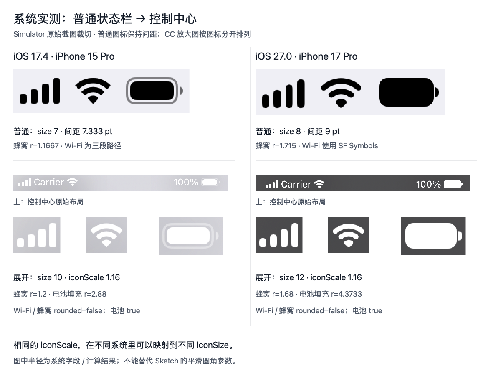
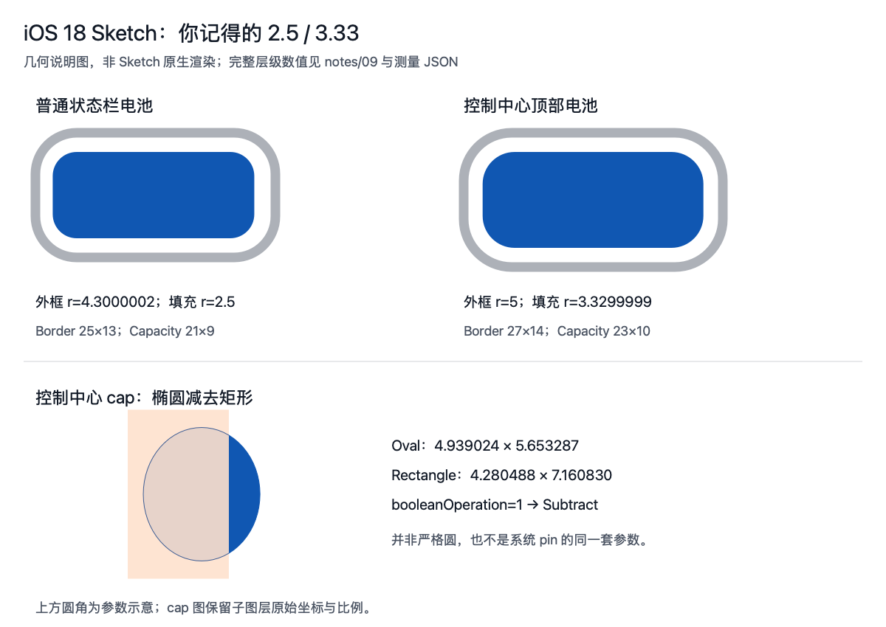
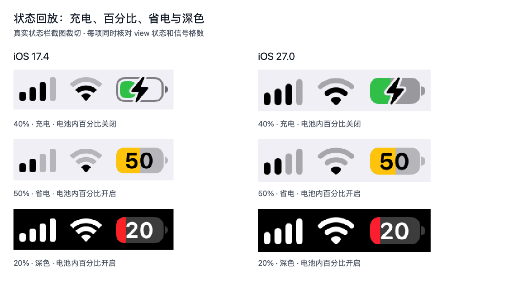

# 10 从设计稿追到系统：展开模式、新 Wi-Fi 与圆角表

本篇把 [09 的两份 Sketch](09-sketch-status-bars.md) 与系统端连接起来。研究基线为
`cd8910f` 后的扩展；运行时为 iOS 17.4 **21E213** / iPhone 15 Pro 和 iOS 27.0 **24A434** / iPhone 17 Pro，均为 arm64 Simulator、3×、竖屏。
代码是根据反汇编和实测手工还原，**不是 Apple 原始源码**。



## 1. 控制中心不是把普通状态栏整体放大

对原始 `STUIStatusBar setMode:` 做透传 hook，记录原调用完成后的栈；打开系统自己的控制中心，而非在探针中自行构造一个“相似”状态栏。两版的实际调用链分别为：

```text
iOS 17.4
CCUIModularControlCenterOverlayViewController _beginPresentationAnimated:interactive:
  → CCUIHeaderPocketView setMode:orientationHint:
  → CCUIStatusBar initWithFrame:
  → STUIStatusBar_Wrapper setMode:
  → STUIStatusBar setMode: 1

iOS 27.0
CCUIMainViewController _beginPresentationAnimated:interactive:
  → CCUIHeaderPocketView setMode:orientationHint:
  → CCUIStatusBar initWithFrame:windowScene:
  → STUIStatusBar_Wrapper setMode:
  → STUIStatusBar setMode: 1
```

`STUIStatusBar` 的 mode、provider 的 expanded、图标自己的 signalMode 是不同字段。
本次普通状态栏为 mode=0 / expanded=false，控制中心为 mode=1 / expanded=true。
`styleAttributesForStyle:` 随模式选择 normal / expanded 的字号、iconScale、iconSize；控制中心还重新放置运营商、信号与独立的电量文本。

| 原生属性 | 17.4 普通 | 17.4 控制中心 | 27.0 普通 | 27.0 控制中心 |
|---|---:|---:|---:|---:|
| iconScale | 1.12 | 1.16 | 1.18 | 1.16 |
| iconSize | 7 | 10 | 8 | 12 |
| provider 普通 / 展开 spacing | 7⅓ | 4 | 9 | 4 |
| 蜂窝 view 宽×高 | 19⅓×12⅓ | 20⅔×13 | 20⅓×13⅔ | 20⅔×13 |
| Wi-Fi view 宽×高 | 17×12⅓ | 17⅔×12⅔ | 17⅔×12⅔ | 17⅔×12⅔ |
| 电池 view 宽×高 | 27⅓×13 | 30×13⅔ | 29×13⅔ | 30⅓×13⅔ |
| 电池计算所得填充 radius | 2.88 | 2.88 | 4.373333 | 4.373333 |

view 宽高取当前实例的 frame；intrinsicContentSize 可能因像素对齐而不同。例如 27 普通蜂窝 intrinsic width=20.5，最终 frame width=20⅓。不能把它们混成同一测量。

普通状态栏的两处实际 view 间距分别都是 17.4 的 7⅓、27 的 9。控制中心的 4 是布局参数，**不意味着三个图标还相邻且相隔 4**：运营商文本插在信号之间，电池移到右侧。

本次时间实际使用 `.SFUI-Semibold` 17 / 18 pt；控制中心运营商和 `100%` 为 `.SFUI-Medium` 15 pt。截图中 `09:41` 与设计稿 `9:41` 的文本不同，不能当作字体轮廓差异。

## 2. iOS 27 的 provider 门槛与档位确实变了

17.4 的全链路见 [08](08-provider-selection.md)。本次扩展 27 的 DynamicSplit 分支，不声称重新验证了全部旧式 Phone / iPad provider。

```text
effectiveWidth = screen._unjailedReferenceBounds.width × screen._nativeScale / screen._scale
medium        = effectiveWidth ≤ 402
smallIsland   = screen._exclusionArea.rect.width ≤ 285
```

两个判断组合选择 `DynamicSplit`、`DynamicSplitMedium`、`DynamicSplitSmallIsland`、`DynamicSplitMediumSmallIsland`。
该 iPhone 17 Pro 的原生 exclusion rect 为 `{{138.333333,14},{125,36.666667}}`，实际选中最后一类。285 是代码比较的原始字段值，不能把它叫作“灵动岛物理宽度像素门槛”，也不能按机型营销名称硬编码。

3× 分支的映射如下；条件为 screenScale > 2.5，输入使用精确 double 比较：

| iconScale | 1.06 | 1.08 | 1.12 | 1.18 | 1.26 | 1.32 | 1.16 | 1.2412 | 1.2992000000000001 | 其他 |
|---|---:|---:|---:|---:|---:|---:|---:|---:|---:|---:|
| iconSize | 4 | 6 | 7 | 8 | 9 | 10 | 12 | 14 | 15 | 2 |

screenScale ≤2.5 时：1.07→5、1.16→11、1.2412→13，其他→1。
normalIconSize 与 expandedIconSize 使用同一映射规律，但读的是不同 scale 属性。
这解释了为什么 1.16 在 17.4 得到 10，在 27 得到 12；枚举序号不是圆角，也不是稳定跨版本尺寸。

独立规则在 75 个 provider 条件 + 96 个 normal/expanded 映射条件下与原生方法比较全部通过，包含 402、285、2.5 两侧边界和 1.1800001 的 fallback。
实现：[ProviderRules27.h](../tools/providers/ProviderRules27.h)；证据：[rules JSON](evidence/statusbar-27-rules.json)。

## 3. 新 Wi-Fi 已经换了绘制路径

27 的普通状态栏和控制中心真实使用 **`STUIStatusBarWifiSignalIconView`**。旧的 `STUIStatusBarWifiSignalView` 仍能创建，但其存在不能证明屏幕仍使用旧的三段路径算法。
新类部分方法是 Swift 实现的 ObjC thunk：先用运行时 IMP 定位精确符号边界，再跟随 thunk 的分支目标，才能看到真正实现。

`_updateImage` 的静态图像部分还原为：

```text
symbolName = "wifi"
variableValue = signalMode == 2 ? numberOfActiveBars / numberOfBars : 1
color = signalMode == 0 ? (inactiveColor ?? tertiaryLabelColor)
                        : (activeColor ?? labelColor)
configuration = pointSize(iconSize) + weight(iconSize) + hierarchicalColor(color)
image = UIImage._systemImageNamed:variableValue:withConfiguration:
```

独立代码用公开的 `systemImageNamed:variableValue:withConfiguration:` 调用同一个系统符号资源。
1–19 档 × 两种 rounded × 5 种静态状态（0–3 格和 inactive）共 **190 张图像 RGBA 最大字节差为 0**。
19 档的 nominal width、height、pointSize、weight、verticalOffset 也与原生类方法逐项比较通过。
实现：[WifiIcon27.h](../tools/statusbar/WifiIcon27.h)；证据：[图像验证](evidence/statusbar-27-wifi-validation.json)。

| 字段 | size 8，普通 | size 12，展开 |
|---|---:|---:|
| nominal width | 17.5 | 17⅔ |
| nominal height | 12⅔ | 12.5 |
| pointSize | 17⅓ | 14⅔ |
| UIImageSymbolWeight | Medium（5） | Heavy（8） |
| verticalOffset | 0 | 0 |

rounded 不参与这段符号配置；同 size、不同 rounded 得到同图像。
size 16 的 verticalOffset 为 −0.5，其他已测档为 0。

**view 框不是 Wi-Fi 的可见轮廓框。** 普通实例的外层 view 是 17⅔×12⅔，里面 UIImageView 的框却是 23×17⅔、x≈−2⅔、y≈−2⅓；其 layer contents 为 59×43 像素。符号有自己的布局余量，不能直接拿外层 view 的 17⅔ 与 Sketch 路径的 19.333 相减并宣称图标小了 1.666。

这次没有重建 SF Symbols 字体内的轮廓生成器，也没有验证 signalMode=1 的搜索动画时间曲线；该分支添加符号动画，其他模式移除符号动画。190 张一致指静态 content image，不是完整 view 和动画全帧一致。

## 4. 蜂窝 rounded=false 也可以更圆

27 的 `STUIStatusBarCellularSignalView` 仍是四个 CALayer；`cornerCurve=continuous`。半径规则仍分 rounded，但非 rounded 的参数表本身发生变化。

| 样本 | 柱宽 | 柱间距 | 非 rounded 半径 | 四根高度 | 垂直偏移 |
|---|---:|---:|---:|---|---:|
| 17.4 普通 size 7 | 3⅓ | 2 | 1⅙ | 4⅔ / 7 / 9⅔ / 12⅓ | 0 |
| 27 普通 size 8 | 3.5 | 2⅙ | 1.715 | 6.5 / 8⅔ / 11⅙ / 13⅔ | 1 |
| 17.4 展开 size 10 | 3⅔ | 2 | 1.2 | 5 / 7 / 10 / 13 | 0 |
| 27 展开 size 12 | 3⅔ | 2 | 1.68 | 5 / 7 / 10 / 13 | 0 |

27 的布局还有 `_verticalOffsetForIconSize:`：size 8 加 1 pt、size 10 加 1⅓，其余已导出 1–19 档为 0。
普通样本最后一根柱子的本地 y=1，其底部超出外层 view 的高度 1 pt；只读 view.bounds 会漏掉这个视觉对齐细节。

```text
x = index × (barWidth + interspace)
if reverse: x = bounds.width − barWidth − x
y = bounds.height − barHeight[index] + verticalOffset
radius = rounded ? barWidth / 2 : radiusTable[iconSize]
```

[Cellular27.h](../tools/statusbar/Cellular27.h) 独立还原 4 / 7 / 8 / 9 / 10 / 12 六档；
6 档 × 2 rounded × 2 排列方向 × 5 信号强度，共 120 组、480 根柱子的 frame、连续圆角设置和 alpha 与原生方法匹配，最大误差 `1.78e-15`。
反向分支通过实验子类覆盖 `_shouldReverseLayoutDirection` 强制进入，**不是完整系统 RTL 验证**。
Core Animation 的 continuous 曲线生成器仍由系统提供，不能把这个验证说成自行实现了它的内部数学算法。

## 5. 与 Sketch 对齐时，哪些数字能直接比较



- iOS 18 原稿：普通 Border r≈4.3 / Capacity r=2.5；控制中心 Border r=5 / Capacity r≈3.33。是不同图层的参数，不是一个 4.33×2.5 的尺寸。
- iOS 18 控制中心 cap 保留椭圆减矩形的布尔结构；系统 pin 的路径构造见 [06](06-legacy-geometry.md)。构形相似不代表控制点、参数或 API 相同。
- 17.4 真实控制中心填充计算半径为 2.88，不能用它替代 iOS 18 原稿的 3.33，也不能据此断言 18 的运行时和原稿不符。
- 27 原稿中的蜂窝 radius=4 / smoothing=.6，与系统 CALayer radius=1.715 / continuous 不是同一个参数空间。原稿的展开路径 point.radius=0 也不表示方角。
- 27 普通组件的相邻 group 间距为 8，实际 provider 的 view spacing=9；时间字号原稿17.67、实测18。图层层级和运行时版本必须写在数字旁边。
- 27 控制中心 Battery group 的子路径有负 x；group.frame 不能代替绘制范围。Wi-Fi 还要区分 SF Symbols 图像框与外层布局框。

## 6. 状态回放与实验工具修正



两个运行时分别回放 40% 充电且百分比关闭、50% 省电且百分比开启、20% 深色且百分比开启。每次检查实际 battery view 的 chargePercent、chargingState、saverModeActive、showsPercentage，以及 Wi-Fi / 蜂窝格数；全部 6 组通过，截图已检查。
这是通过 SystemStatus 覆盖发布的**数据到绘制验证**，没有冒充在 Settings 点击开关的偏好持久化验证。

`showsPercentage`、`showsInlineChargingIndicator` 控制具体内容呈现；provider 的 rounded 控制几何分支，两层不能混为“电池百分比开关选择机型样式”。充电闪电边缘的镂空 / 合成机制沿用 [04](04-legacy-battery.md) 与 [06](06-legacy-geometry.md) 的证据。

回放中发现旧 `batovr` 的 completion 声明了不使用的 `id` 参数，17.4 回调未提供对象，ARC 随后 retain 无效寄存器值，发布数据后崩溃。改成不读取 payload 的 completion，补充参数数量检查；修复后两版发布进程均正常退出，重新执行全部 6 组通过。状态脚本现在也检查发布进程退出码，不能只因截图看起来对就漏过崩溃。

## 7. 复现入口

仅对自己创建的实验设备注入，始终传具体 UDID。不要使用泛指 `booted`，不要重启用户的其他设备。

```sh
zsh tools/statusbar/build.sh
zsh tools/battery/build.sh
# 每台设备使用独立目录，例如 .build/statusbar/27-0
python3 tools/statusbar/capture.py "$UDID" "$OUT" methods --inject
xcrun simctl launch "$UDID" com.apple.Preferences
xcrun simctl status_bar "$UDID" override --time '9:41' --batteryState discharging --batteryLevel 100 \
  --wifiMode active --wifiBars 3 --cellularMode active --cellularBars 4 --operatorName Carrier
python3 tools/statusbar/capture.py "$UDID" "$OUT" normal
python3 tools/statusbar/capture.py "$UDID" "$OUT" cc-open
python3 tools/statusbar/capture.py "$UDID" "$OUT" cc-close
python3 tools/statusbar/states.py "$UDID" "$OUT"

# 以下三项只在 27.0 执行；路径应展开为主机绝对路径
xcrun simctl spawn "$UDID" "$PWD/.build/statusbar/rulesprobe" "$PWD/$OUT/rules.json"
xcrun simctl spawn "$UDID" "$PWD/.build/statusbar/wifiverify" "$PWD/$OUT/wifi-verify"
xcrun simctl spawn "$UDID" "$PWD/.build/statusbar/cellverify" "$PWD/$OUT/cell-validation.json"

# 在另一个终端保留探针进程，读取其打印的 PID
xcrun simctl spawn "$UDID" "$PWD/.build/statusbar/runtimeprobe" "$PWD/$OUT/runtime" --wait
python3 tools/statusbar/export_disassembly.py "$PID" "$OUT/runtime" notes/evidence/statusbar-27-methods.asm

# 两版目录完成后导出证据与图，不提交原稿、完整 runtime inventory 或 Apple 二进制
python3 tools/statusbar/evidence.py .build/statusbar notes/evidence
xcrun swift tools/statusbar/figures.swift .build/statusbar docs/images
```

注入后 SpringBoard 首轮 UI 可能尚未填充；采集器最多等待 30 秒，并检查图标层级可见性与控制中心状态。层级 visible 并不是通用遮挡检测，所以还需要查看实际截图。启动时的空状态栏没有纳入接受证据。

原生方法证据：[17.4](evidence/statusbar-17-methods.asm)、[27.0 与 Swift 实现](evidence/statusbar-27-methods.asm)；
实际布局、逐项目覆盖与调用栈：[modes JSON](evidence/statusbar-modes.json)；
蜂窝验证：[cell JSON](evidence/statusbar-27-cell-validation.json)。

## 8. 完成范围与尚未完成

| 范围 | 当前证据 |
|---|---|
| 旧电池外框、填充、cap、闪电合成 | 04–06：17.4 路径、27 电池绘制与对照 |
| 旧 Wi-Fi / 蜂窝、刘海与灵动岛 | 07：17.4 三机型几何与像素验证 |
| 旧 provider 全链路 | 08：516 次原生规则比较与逐项目覆盖 |
| 两份 Sketch 普通 / CC 的几何 | 09：原始字段、来源哈希；18 缓存 / original 10 组一致 |
| CC mode → expanded → scale/size/布局 | 本篇：17.4 / 27.0 原始调用栈与实际截图 |
| 27 DynamicSplit provider 与新信号绘制 | 本篇：171 条件、19 档 Wi-Fi 参数、190 图像、480 蜂窝柱 |
| iOS 18 系统端 | **未完成**：当前仅有设计稿；Xcode 的 18.5 arm64/universal 和 18.6 下载请求均不可用 |
| Sketch 原生像素渲染 | **未完成**：未安装 Sketch；本次测量 JSON 和示意图不冒充原生渲染 |
| 真机、完整 RTL、横屏、双 SIM、显示缩放、搜索动画全帧 | **未验证**；强制反向分支不等于整机 RTL |
| 其他状态项，如定位、VPN、录制/通话 pill、iPad/CarPlay | 不在本次四项核心视觉研究的已完成范围 |

这次补齐的是**时间、电池、Wi-Fi、蜂窝从设计层级到 provider 和实际渲染的主要链路**。
要称作“所有版本、所有 status bar 状态通关”还缺上表范围；尤其必须获取 iOS 18 运行时后，才能结束 3.33 与系统实际实现的同版本核对。
